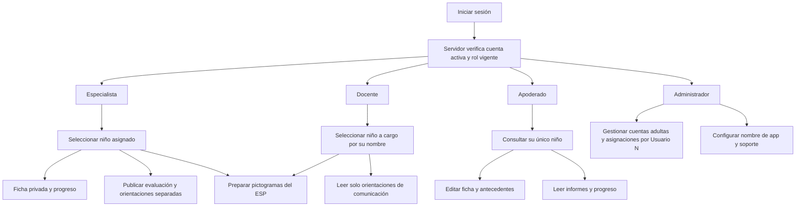

# STCS: flujo y permisos por perfil

Se implementan cuatro tipos de cuenta adulta, no un límite de cuatro personas.
Los niños son perfiles de atención y no inician sesión en el portal adulto.

| Capacidad | Especialista | Docente | Apoderado | Administrador |
| --- | --- | --- | --- | --- |
| Seleccionar niños | Varios asignados | Varios asignados | Máximo uno | Solo identificadores numerados |
| Identidad | Nombre completo | Solo nombre, sin apellidos | Nombre completo | Usuario N |
| Datos sensibles | Leer | Sin acceso | Leer y editar | Sin acceso |
| Actividad y progreso | Leer | Sin acceso | Leer | Sin acceso |
| Pictogramas del ESP | Crear, editar y retirar | Crear, editar y retirar | Consultar | Sin acceso |
| Diagnóstico e informes | Publicar y leer | Sin acceso | Leer | Sin acceso |
| Orientaciones de comunicación | Publicar y leer | Leer | Leer | Sin acceso |
| Adultos y asignaciones | Sin acceso | Sin acceso | Sin acceso | Crear, editar y desactivar |
| Configuración global | Sin acceso | Sin acceso | Sin acceso | Nombre de app y correo de soporte |

## Decisiones de privacidad

- Un docente no recibe diagnóstico, notas privadas, edad, contexto, métricas ni
  historial, incluso si llama directamente a una ruta antigua de la API.
- Las orientaciones son un campo separado. El especialista debe escribir allí
  apoyos de comunicación sin incluir información clínica.
- La numeración es estable en la base. El administrador recibe solamente el
  identificador técnico y Usuario N; no recibe nombres, dispositivos ni eventos.
- Una asignación debe coincidir con el rol vigente del adulto. Los cambios de
  rol y las desactivaciones se comprueban en cada solicitud, sin confiar en el
  rol antiguo guardado en el navegador o token.
- Los endpoints de hardware entregan el identificador del tablero, no la ficha
  clínica ni el nombre del niño. La edición del tablero se guarda para que el
  ESP la obtenga con su mecanismo existente de descarga de configuración.
- Los informes son históricos: una nueva evaluación se agrega con autor y fecha,
  conservando las anteriores. No se generan diagnósticos automáticos.
- Las cuentas se activan y recuperan verificando el correo mediante código de Supabase. El administrador no elige contraseñas ni modifica correos existentes.
- Las nuevas asignaciones clínicas requieren aprobación de otro especialista o apoderado ya autorizado para ese niño. No se permite autoaprobarse. Las asignaciones históricas se conservan y se revisan en cada petición.
- Las cuentas se desactivan sin borrar su trazabilidad. No se permite desactivar
  la propia cuenta administrativa ni eliminar el último administrador activo.
- El inicio de sesión ya no crea tablas ni reescribe contraseñas demo.

## Implementación y pruebas

- Matriz compartida: frontend/src/lib/permissions.ts.
- Autorización y proyecciones: frontend/src/lib/server/portal.ts y access.ts.
- API del portal: /api/stcs/portal. Rutas antiguas conservadas con restricciones.
- Interfaz: portal.tsx, portal-forms.tsx y componentes existentes del comunicador.
- Migración: supabase/migrations/20261111163114_role_based_portal.sql.
  Aplicada a STCS; agrega campos, informes y configuración sin reemplazar datos.
- RLS habilitado y acceso directo anon/authenticated cerrado en tablas nuevas y
  en las tablas antiguas de registros y emociones. La API Node autentica y filtra
  porque la conexión PostgreSQL del servidor es privilegiada.
- La suite aislada verifica roles, aprobaciones, credenciales del titular, rutas antiguas, permisos, reportes idempotentes, dispositivos, paginación y concurrencia. Consulta docs/PRUEBAS.md para preparar PostgreSQL local y ejecutarla sin tocar producción.
- Figma pidió seleccionar un equipo; se usó la alternativa autorizada de diseño
  directo en la app. No se afirma que exista un diseño Figma generado.

El entorno normal de desarrollo y producción comparten la base existente de STCS. La suite aislada usa otro PostgreSQL y rechaza bases remotas o servidores que no confirmen su aislamiento. No ejecutar seeds para validar roles.

La primera incorporación de responsables clínicos en una instalación sin ninguno autorizado exige validar sus identidades fuera del rol administrativo y asignarlas mediante una operación de mantenimiento autorizada. El portal nunca permite al administrador saltarse esa aprobación.

## Perfiles demo en la nube

/demo muestra tres accesos con correos ficticios y contraseña de demostración. Ingresan por /login y usan las mismas sesiones revocables, pantallas y API que las cuentas reales. El único administrador es la cuenta real del propietario. Ya no existe transporte de datos simulado en el navegador.

Las cuentas y niños demo tienen is_demo persistido en PostgreSQL. Solo ese indicador de la base permite omitir la activación, nunca el dominio del correo ni una propiedad del JWT. No puede cambiarse desde el portal ni convertirse una cuenta demo en administradora. Las asignaciones entre demo y real se rechazan en API y mediante restricciones de base. Las rutas antiguas aplican la misma separación.

Se crean dos niños ficticios, tableros, informes y eventos de ejemplo compartidos. Los eventos de muestra llevan source=demo-fixture y solo cuentan en consultas de cuentas demo. Los dispositivos de muestra quedan offline hasta enlazar hardware auténtico; no se simula una conexión. El dispositivo existente conserva su asignación y configuración.

Los cambios persisten en Supabase y el script de aprovisionamiento no restablece usuarios, fichas, informes ni tableros editados. Las cuentas y fichas preexistentes quedan intactas. El inicio de sesión no ejecuta el aprovisionamiento.

## Activación de futuras cuentas reales

El administrador crea una cuenta con el correo real y el rol correspondiente. El botón «Copiar enlace de activación» genera /activate?email=... para compartir con el titular; el enlace no contiene una contraseña ni un secreto y no verifica por sí mismo la identidad. El destinatario solicita y verifica el código enviado a ese correo y elige su contraseña. Funciona para especialistas, docentes, apoderados y futuros administradores. Las cuentas nuevas reales nunca heredan la excepción demo. Las aprobaciones clínicas se mantienen, incluida la validación inicial fuera del rol administrativo cuando aún no existe un responsable autorizado.
