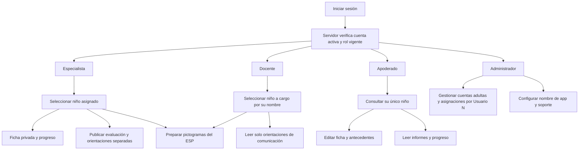

# STCS: flujo y permisos por perfil

Se implementan cuatro tipos de cuenta adulta, no un límite de cuatro personas.
Los niños son perfiles de atención y no inician sesión en el portal adulto.

| Capacidad | Especialista | Docente | Apoderado | Administrador |
| --- | --- | --- | --- | --- |
| Seleccionar niños | Varios asignados | Varios asignados | Máximo uno | Solo identificadores numerados |
| Identidad | Nombre completo | Solo nombre, sin apellidos | Nombre completo | Usuario N |
| Datos sensibles | Leer | Sin acceso | Leer y editar | Sin acceso |
| Actividad y progreso | Leer | Sin acceso | Leer | Sin acceso |
| Pictogramas del ESP | Crear, editar y retirar | Crear, editar y retirar | Consultar | Sin acceso |
| Selección de categorías/pictogramas visibles | Configurar por niño | Consultar, sin modificar selección | Consultar | Sin acceso |
| Fecha de inicio de uso | Registrar y consultar | Sin acceso | Consultar | Sin acceso |
| Observaciones del docente | Leer las del perfil asignado | Enviar y leer solo las propias | Sin acceso | Sin acceso |
| Diagnóstico e informes | Publicar y leer | Sin acceso | Leer | Sin acceso |
| Orientaciones de comunicación | Publicar y leer | Leer | Leer | Sin acceso |
| Adultos y asignaciones | Sin acceso | Sin acceso | Sin acceso | Crear, editar y desactivar |
| Configuración global | Sin acceso | Sin acceso | Sin acceso | Nombre de app y correo de soporte |

## Decisiones de privacidad

- Un docente no recibe diagnóstico, notas privadas, edad, contexto, métricas ni
  historial, incluso si llama directamente a una ruta antigua de la API.
- Las orientaciones son un campo separado. El especialista debe escribir allí
  apoyos de comunicación sin incluir información clínica.
- La numeración es estable en la base. El administrador recibe solamente el
  identificador técnico y Usuario N; no recibe nombres, dispositivos ni eventos.
- Una asignación debe coincidir con el rol vigente del adulto. Los cambios de
  rol y las desactivaciones se comprueban en cada solicitud, sin confiar en el
  rol antiguo guardado en el navegador o token.
- Los endpoints de hardware entregan el identificador del tablero, no la ficha
  clínica ni el nombre del niño. La edición del tablero se guarda para que el
  ESP la obtenga con su mecanismo existente de descarga de configuración.
- Los informes son históricos: una nueva evaluación se agrega con autor y fecha,
  conservando las anteriores. No se generan diagnósticos automáticos.
- Las cuentas se activan y recuperan verificando el correo mediante código de Supabase. El administrador no elige contraseñas ni modifica correos existentes.
- Las nuevas asignaciones clínicas requieren aprobación de otro especialista o apoderado ya autorizado para ese niño. No se permite autoaprobarse. Las asignaciones históricas se conservan y se revisan en cada petición.
- Las cuentas se desactivan sin borrar su trazabilidad. No se permite desactivar
  la propia cuenta administrativa ni eliminar el último administrador activo.
- El inicio de sesión ya no crea tablas ni reescribe contraseñas demo.

## Implementación y verificación

Matriz compartida en permissions.ts; autorización y proyecciones en portal.ts/access.ts; claves del ESP en deviceAuth.ts. La API filtra cada solicitud porque su conexión SQL es privilegiada; RLS y revocaciones complementan ese control. [Pruebas y alcance](pruebas/RESULTADOS.md).

Las cuentas reales se activan/recuperan por código de correo y el titular elige contraseña. Admin no modifica correos existentes ni contraseñas. Nuevas asignaciones clínicas requieren otro responsable autorizado; la primera incorporación sin responsable se valida fuera del rol administrativo.

## Entorno de demostración

Luis es ficticio y tiene un ESP físico. Sus adultos públicos de prueba usan is_private_test y correos ficticios; solo esa marca persistida permite la excepción de activación. El portal no puede modificarla ni mezclar cohortes o convertir esas cuentas en administradores. Los accesos están en README y /demo está retirado.

Las cuentas reales requieren verificación y asignación aprobada. Los cambios persisten y el login no crea tablas, repuebla demos ni reescribe contraseñas. Las orientaciones al docente son texto separado: el especialista debe evitar incluir clínica en ese campo.

## Alcance de administración de equipos — 17/11/2026

Los ESP se entregan previamente configurados y asociados técnicamente a un perfil. Los adultos conservan el acceso por asignaciones autorizadas y las aprobaciones existentes; el cierre TCS-53 no permite al administrador obtener identidades ni datos clínicos. Vincular por posesión, rotar la clave técnica o reasignar equipos íntegramente desde web se difiere a FUT03, sin implementación acreditada. Las tareas técnicas se comprueban mediante pruebas. La aprobación de pertinencia de Heriber y su alcance constan en [A3](historias.md).

## Adaptación y seguimiento publicados

El catálogo conserva los pictogramas ocultos. Una selección explícita no incorpora automáticamente nuevos pictogramas creados por el docente: decide el especialista. No se puede retirar o mover el último pictograma visible sin ajustar primero la selección. Fecha y observaciones se guardan por perfil; los envíos docentes tienen un identificador para evitar duplicados al reintentar. Las observaciones son apoyos de comunicación, no diagnósticos ni progreso. Las migraciones aditivas están aplicadas en Supabase y sus permisos se comprobaron en la [publicación final](pruebas/reportes/comprobacion-final-20261121/README.md).
