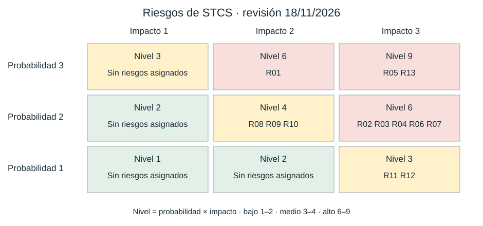
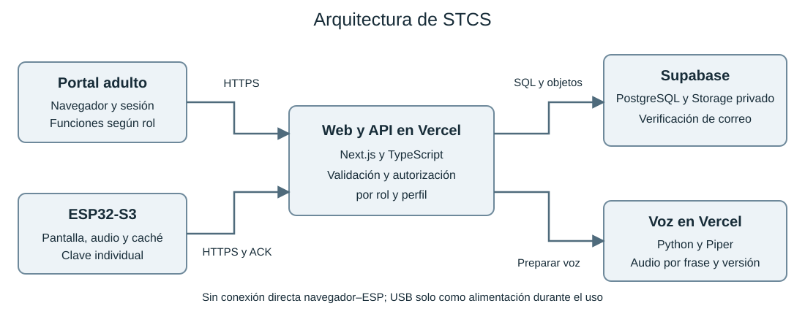
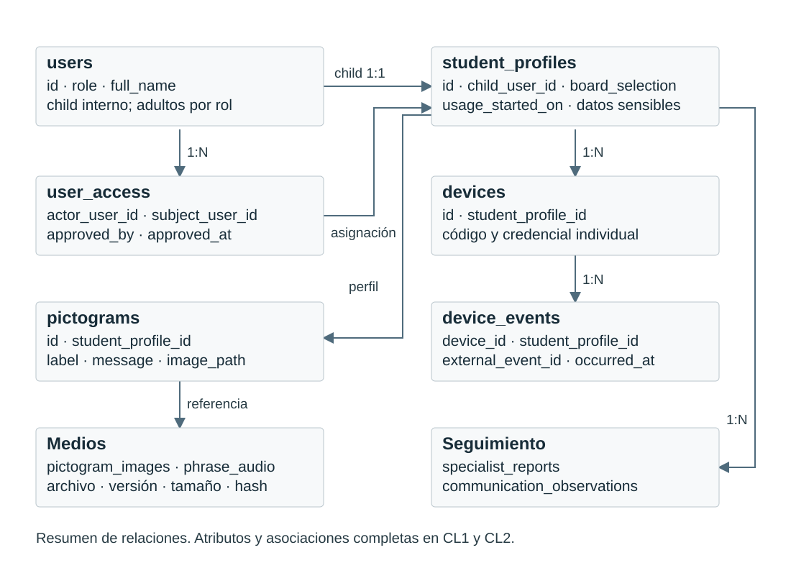

# STCS Sistema TEA de Comunicación y Seguimiento

Informe de Proyecto de Título

Hitos 1 2 y 3

Ignacio Javier Benegas Guzmán

Ingeniería en Computación e Informática

Universidad Andrés Bello

Profesores guía Matías Vargas y César Cheuque

Viña del Mar Chile

Noviembre de 2026

## Resumen

STCS es un prototipo de Comunicación Aumentativa y Alternativa que combina un comunicador ESP32-S3 con pantalla táctil y una plataforma web para los adultos responsables. Su propósito es apoyar la expresión de necesidades, emociones y mensajes de niños con TEA que requieren apoyo comunicativo. El niño utiliza pictogramas y voz en el dispositivo; el especialista configura el apoyo desde la web y cada adulto accede solo a la información que le corresponde.

El semestre avanzó desde la definición del problema y el diseño del Hito 1 hasta la integración del Hito 2 y las pruebas de seguridad, continuidad, privacidad y pertinencia del Hito 3. Se verificaron personalización, persistencia, eventos, historial, configuración Wi-Fi y separación de perfiles. Los ensayos del hardware establecieron un máximo operativo de 180 pictogramas activos, 45 por categoría. El catálogo base publicado incluye 91 opciones ARASAAC; ese número no es el límite de registros activos ni un recuento del tablero instalado.

Heriber Galleguillos aprobó los flujos mostrados en la demostración guiada del 20 de noviembre, con la condición de adaptar la complejidad del tablero a cada niño. Después incorporé selección de categorías y pictogramas, fecha de inicio y observaciones docentes. La repetición limpia del 22 de noviembre sobre a3d096f registró 15 unitarias, 40 recorridos de navegador, una suite de 387 comprobaciones API y 90,05 % de cobertura de líneas en servidor. Son resultados de laboratorio; los ensayos físicos y de nube conservan sus registros propios.

El resultado es un prototipo integrado con evidencia técnica y revisión profesional adulta. No se realizó un ensayo con niños ni se midió eficacia terapéutica. La voz sin Wi-Fi, el tacto inferior y el alcance de la versión instalada forman parte de sus límites. El informe conserva estas distinciones para que los resultados puedan comprobarse sin atribuirles un alcance mayor.

## 1 Introducción

La comunicación permite expresar necesidades, preferencias y emociones. Cuando un niño necesita apoyos para comunicarse, la herramienta debe ajustarse a sus capacidades de acceso y al vocabulario que utiliza. En STCS se separó la interacción infantil del trabajo de configuración: el dispositivo presenta opciones y reproduce mensajes, mientras la web permite a los responsables adaptar el contenido y consultar la información autorizada.

Este informe actualiza el documento acumulativo de los Hitos 1 y 2 e incorpora el trabajo del Hito 3. Mantiene sus secciones de problema, objetivos, factibilidad, gestión, diseño, pruebas y conclusiones. Los anexos incluyen las fichas por historia y la trazabilidad; el repositorio conserva los reportes ejecutados y los modelos completos. La evidencia se organiza según los artefactos A1–A9 y también responde a las observaciones sobre Sprint Goal, tareas por HU, impedimentos, review y retrospectiva del informe anterior.

En este documento, TEA significa trastorno del espectro autista; CAA, Comunicación Aumentativa y Alternativa; y MVP, producto mínimo viable, denominado MPV en la rúbrica. HU identifica una historia de usuario y CA, su criterio de aceptación. Uso ESP para referirme al comunicador ESP32-S3, API para la interfaz del servidor y E2E para las pruebas que recorren navegador, servidor y base de datos. CI es la verificación automática de cambios y ADR, el registro de una decisión arquitectónica. El percentil 95 o p95 es el tiempo que no supera el 95 % de las peticiones del ensayo.

## 2 Contexto y origen del problema

El proyecto nace de las dificultades de comunicación de niños con TEA que requieren apoyo para expresar mensajes. Si el medio disponible no se ajusta a sus necesidades, el adulto debe interpretar el mensaje y puede no comprenderlo. STCS plantea una vía adicional mediante pictogramas y voz; la conexión entre web, dispositivo y base de datos permite administrarla, pero no constituye por sí misma el problema de origen.

Los actores son el niño, el especialista, el apoderado, el docente y el administrador. El especialista necesita adaptar el apoyo; el apoderado acompaña al niño y mantiene sus datos; el docente facilita la comunicación con orientaciones permitidas. El administrador mantiene cuentas y configuración sin recibir identidades ni información clínica infantil. El proyecto no presupone que todos los niños con TEA tengan las mismas capacidades o necesiten la misma organización del tablero.

Durante el Hito 1 se analizaron también sugerencias de pictogramas. Se conservaron como diseño para no añadir decisiones automáticas sin evaluación de pertinencia. El problema comunicativo y la personalización siguen siendo el centro de la propuesta.

## 3 Marco teórico y estado del arte

### 3.1 Comunicación aumentativa y alternativa

La CAA comprende recursos que complementan o compensan dificultades de comunicación. Puede incluir símbolos y dispositivos generadores de voz; su elección requiere considerar las necesidades de cada persona [1]. En STCS, el pictograma representa el mensaje, la etiqueta ayuda a interpretarlo y la frase escrita determina el audio. No se establece un requisito general de edad, habla o capacidad cognitiva para acceder a apoyos de CAA.

Kasari y colaboradores estudiaron dispositivos de voz dentro de una intervención estructurada con niños mínimamente verbales [2]. Ese trabajo aporta contexto, pero sus efectos no son resultados de STCS. Light y colaboradores revisan la relación entre diseño de pantallas de CAA, atención y desempeño [3]; fundamentan la revisión de cantidad, organización y reconocimiento de símbolos, sin convertir cuatro opciones por página en una regla clínica universal.

### 3.2 Pictogramas y acceso

El catálogo publicado reúne 91 opciones ARASAAC, con autor, propietario, licencia y origen por archivo [4]. Las imágenes conservan proporción, margen blanco e independencia respecto de la frase. Inseguridad, Frustración y Entusiasmo quedaron fuera del selector inicial hasta revisión del símbolo; sus imágenes anteriores se conservan para registros existentes. Las imágenes propias mantienen su procedencia y no se atribuyen a ARASAAC.

Los controles importantes se ubicaron arriba y en los laterales porque el tacto inferior del equipo respondió mal. La frase se mantiene abajo como zona de lectura. Esta distribución mitiga el acceso, sin reparar el panel. La personalización por especialista permite reducir la cantidad de opciones y categorías visibles, según la necesidad individual.

### 3.3 Soluciones concretas y aporte del proyecto

| Solución | Característica documentada | Relación con STCS |
| --- | --- | --- |
| Cboard [5] | Aplicación abierta de comunicación con símbolos y texto a voz | Ofrece una vía basada en navegador; STCS explora un comunicador físico dedicado |
| Proloquo2Go [6] | CAA con símbolos y personalización para iPad/iPhone | Producto especializado de mayor alcance; no se afirma equivalencia clínica |
| STCS | ESP dedicado, configuración web por rol y eventos por perfil | Integra el equipo adquirido con administración separada y privacidad por responsabilidad |

La comparación es documental, no un ensayo de superioridad o de precios. Heriber recomendó además LetMeTalk como referencia y ARASAAC como fuente de símbolos. El aporte académico consiste en construir y comprobar esta integración, con sus decisiones y restricciones.

## 4 Identificación de la problemática

| Necesidad o dificultad | Consecuencia posible | Respuesta de STCS |
| --- | --- | --- |
| Expresar un mensaje con apoyos ajustados al niño | Mensaje no comprendido o dependencia de interpretación adulta | Pictograma, etiqueta y voz personalizables |
| Pantalla pequeña y recorrido de varios pasos | Dificultad para acceder al mensaje | Hasta cuatro opciones visibles y tablero reducible por especialista |
| Contenido distinto entre responsables o equipo | Apoyo inconsistente | Catálogo por perfil y sincronización autenticada |
| Datos sensibles compartidos sin distinción | Exposición de identidad o clínica | Permisos y proyecciones en servidor |
| Interrupción de red o reinicio | Retraso de sincronización y eventos | Caché acotada, cola persistente y reintento con el mismo ID |

La hipótesis de solución es que un comunicador personalizable puede ofrecer un apoyo adicional de expresión. La hipótesis técnica comprobable es que el adulto puede cambiar el mensaje sin recompilar el ESP y que el acceso permanece limitado al responsable autorizado. No se midió una reducción clínica de dificultades comunicativas ni existe línea base infantil para afirmarla.

## 5 Alcance y objetivos

### 5.1 Objetivo general

Desarrollar un prototipo funcional de comunicación aumentativa basado en un dispositivo ESP32-S3 con pantalla táctil redonda y una plataforma web de configuración y seguimiento, con el propósito de apoyar la comunicación de niños con TEA mediante pictogramas.

### 5.2 Objetivos y resultados

Se conservan los siete objetivos técnicos de Hito 2 y su equivalencia con los cinco del informe anterior en [A1](objetivos.md). La tabla resume la medición disponible; la línea base no medida se declara como tal y no se reemplaza por cero.

| Objetivo | Métrica y meta | Referencia y método | Resultado |
| --- | --- | --- | --- |
| H2-OE1 Interfaz táctil | ≥3/4 tareas sin ayuda en operación externa | Sin línea base externa; PA-01/02/04 | Flujo aprobado por el stakeholder en la demostración guiada del 20/11, condicionado a simplificar por niño. Comprobé el cambio en el ESP el 22/11; autonomía, tiempo, errores y ayudas no medidos |
| H2-OE2 Navegación y frase | 2/2 secuencias correctas | Selección/voz frente a orden previsto; PF-01 | Flujo aprobado cualitativamente en la demostración guiada. Operación física conforme; dos secuencias autónomas, tiempos, errores y ayudas externos sin medir |
| H2-OE3 Persistencia | 2/2 cambios persistentes y 0 fugas en negativos elegidos | Guardar, recargar y comparar por perfil; API/E2E | Conforme en casos ejecutados |
| H2-OE4 Sincronización | 2/2 cambios coincidentes sin recompilar | Seis cambios PC-01 LAN; tiempo descriptivo | 6/6 aplicados; 7,836–16,889 s; no garantía ≤15 s |
| H2-OE5 Eventos e historial | Una fila por ID reintentado y orden correcto | API y PF-03–05/08 | Suite conforme; pruebas físicas informadas sin conteo instrumentado |
| H2-OE6 Calidad técnica | Cobertura ≥70 %, p95 ≤2000 ms y errores <1 % | Servidor aislado, c8 y etapas de carga, 22/11 | 90,05 % líneas; p95 26,20/40,87 ms y 0 errores; indicadores técnicos sin validación del stakeholder |
| H2-OE7 Predicción diseñada | Flujo, entradas, elección manual y límites documentados | Revisión del diseño FUT01 | Diseño disponible; motor no implementado |

La revisión del profesional valida pertinencia y observaciones de uso con el alcance registrado, no esos indicadores cuantitativos. En particular, no se midieron autonomía, errores y ayudas por tarea con un evaluador externo. Esta separación evita interpretar conformidad técnica como eficacia terapéutica.

### 5.3 Alcance del MVP

Se incluyen roles y asignaciones, imágenes y frases propias, voz preparada en servidor, selección de tablero por especialista, configuración Wi-Fi, eventos, historial, filtros y exportación autorizada. El límite operativo es 180 activos, 45 por categoría y cuatro por página. El tablero de referencia de los ensayos tiene 96 elementos; la cifra no se presenta como consulta actual de producción.

La predicción, una flota mayor, la vinculación/rotación/reasignación integral del hardware desde web, batería, reparación táctil y voz offline garantizada son evolución futura. Los ESP se entregan previamente configurados para su perfil. El prototipo no realiza diagnóstico automático ni ha sido evaluado con menores.

## 6 Levantamiento de requerimientos

### 6.1 Requerimientos funcionales

Los requisitos actuales tienen prefijo H3 para no cambiar el significado de RF-01–08 del Hito 2. Por ejemplo, RF-03 histórico se refiere a la frase y sus controles; H3-RF03 corresponde a personalización. RD-01 se conserva como antecedente de diseño y se identifica actualmente como FUT01, sin presentarlo como función implementada.

| ID | Tipo | Descripción verificable | Prioridad | Objetivo asociado |
| --- | --- | --- | --- | --- |
| H3-RF01 | Funcional | Portal adulto con sesión y roles therapist, teacher, guardian y admin; child no accede al portal | Must | OE3 |
| H3-RF02 | Funcional | Consultar únicamente perfiles asignados; admin sin identidad/clínica y teacher sin diagnóstico/progreso, incluso por API directa | Must | OE3 |
| H3-RF03 | Funcional | Crear/editar imagen, nombre, categoría y frase independientes con validación; preparar y reproducir la voz vigente | Must | OE2 |
| H3-RF04 | Funcional | Mostrar hasta cuatro categorías según la selección del especialista y páginas; seleccionar, Hablar, Borrar y conservar la frase al navegar | Must | OE1 |
| H3-RF05 | Funcional | Persistir eventos autenticados del dispositivo por perfil; ACK del identificador y reintento sin duplicados | Must | OE4 |
| H3-RF06 | Funcional | Configurar Wi-Fi desde celular y mostrar conectado/desconectado en el ESP | Must | OE1/OE4 |
| H3-RF07 | Funcional | Separar informes del especialista de las orientaciones que recibe el docente | Should | OE3 |
| H3-RF08 | Funcional | Recuperar último tablero y recursos disponibles en caché acotada tras reinicio/pérdida de servidor | Should | OE4 |
| H3-RF09 | Funcional | Administrar adultos y aprobaciones de asignación sin acceso clínico del admin; hardware previamente configurado para su perfil | Should | OE3 |
| H3-RF10 | Funcional | Consultar historial, filtrar y exportar datos autorizados del perfil | Should | OE4 |
| H3-RF11 | Funcional | Admitir hasta 180 pictogramas activos, 45 por categoría; rechazar exceso conservando tablero válido | Should | OE2 |
| H3-RF12 | Funcional | Solo el especialista asignado elige categorías y pictogramas visibles por niño, sin borrar el catálogo ni permitir una selección vacía; con una categoría el ESP evita el paso de elegir categoría | Must | OE1/OE2 |
| H3-RF13 | Funcional | Especialista registra fecha de inicio; apoderado la consulta. Docente envía observaciones de comunicación al especialista y consulta solo las propias, sin diagnóstico o progreso | Should | OE2/OE3 |
| H3-RNF01 | Seguridad | Rechazar accesos prohibidos sin datos restringidos y tratar hallazgos altos/críticos de las comprobaciones seleccionadas | Must | OE3 |
| H3-RNF02 | Eficiencia | Portal local con p95 ≤2000 ms y errores <1% en etapas de 5/10 clientes, 15 s cada una | Must | OE4 |
| H3-RNF03 | Mantenibilidad | Suites/tipos/build aprobados y cobertura ≥70% de líneas del alcance de servidor declarado | Should | OE4 |
| H3-RNF04 | Recuperación | Recuperar el tablero de referencia de 96 tarjetas y reintentar hasta 64 eventos pendientes sin duplicar tras ACK | Should | OE4 |

Los permisos se comprueban en servidor, incluidas rutas antiguas y peticiones directas. El docente recibe nombre permitido y orientaciones; no diagnóstico ni progreso. El administrador recibe perfiles enumerados, sin identidad o clínica. El especialista y el apoderado acceden a los perfiles autorizados; child no inicia sesión en el portal adulto.

### 6.2 Escenarios de calidad

| Escenario | Estímulo y entorno | Respuesta y medida |
| --- | --- | --- |
| Seguridad H3-RNF01 | Rol sin permiso intenta API o perfil ajeno en laboratorio | Rechazo o proyección permitida, sin datos restringidos; cero altos/críticos sin tratar y medios explicados |
| Eficiencia H3-RNF02 | 5/10 clientes consultan portal durante 15 s por etapa en localhost | p95 ≤2000 ms y errores <1 % |
| Mantenibilidad H3-RNF03 | Cambio de reglas o interfaz del candidato | Tipos, build y suites conformes; cobertura de líneas de servidor ≥70 % |
| Recuperación H3-RNF04 | Corte de red o reinicio del equipo | Último tablero y recursos disponibles; hasta 64 eventos reintentados sin duplicar tras ACK |

Fuente, estímulo, entorno, respuesta y medida detallados están en [A2](requerimientos.md). La carga local no establece un SLA ni el rendimiento de Vercel. Los límites no se amplían a partir de que una compilación termine correctamente.

## 7 Estudio de factibilidad

### 7.1 Técnica

El proyecto reutiliza la placa Waveshare ESP32-S3-Touch-LCD-1.46B y los servicios STCS existentes. Se separan UI, red, audio, almacenamiento y datos; la tarea de red no debe bloquear la interacción. La compilación operativa v0.8.8 usa 1.987.245 bytes de programa y 146.616 bytes estáticos de RAM. Son tamaños de compilación, no memoria libre durante uso. La caché conserva un límite total de 512 KiB; el atlas de imágenes puede ocupar hasta 384 KiB de ese mismo presupuesto y se mantiene una reserva de 256 KiB para metadatos y eventos. Su ampliación responde al mayor tamaño de las imágenes ARASAAC, sin aumentar el máximo de 180 pictogramas ni prometer voz offline. El 88 % de flash y 58 % de RAM del informe anterior corresponde a otra versión y no se conserva como medida actual.

El ensayo de capacidad avanzó por 64, 128, 160 y 180 pictogramas. El propietario confirmó navegación por doce páginas por categoría, combinación de selecciones y correspondencia de frases distintas. Un tablero de 184 fue rechazado y se conservó el válido. El resultado establece un máximo operativo probado, no el límite físico absoluto. Las imágenes y voces se conservan con caché acotada; no se guardan permanentemente todos los medios.

### 7.2 Económica

| Concepto | Desembolso informado |
| --- | --- |
| Una unidad Waveshare con pantalla y componentes incluidos | $30.942 CLP |
| Cable USB reutilizado | $0 adicionales |
| Vercel, Supabase y correo hasta el 18/11 | $0 CLP |
| Total de adquisición y servicios informado | $30.942 CLP |

El valor proviene de la captura del pedido y del registro de adquisición del proyecto. No desglosa impuestos/envío ni estima horas, internet, mantenimiento, batería, carcasa o un segundo equipo. Que no se haya pagado por servicios no garantiza gratuidad permanente ni representa el costo de una unidad comercial. [Detalle](factibilidad.md).

### 7.3 Legal social y operativa

La protección de datos se analiza con la Ley 19.628 y la Ley 21.719 [7, 8], considerando el carácter sensible de la información de salud. El proyecto usa datos ficticios y limita accesos por responsabilidad. Esas medidas no certifican cumplimiento normativo completo. Un uso con menores requiere revisión de finalidades, consentimiento, conservación, permisos y condiciones aplicables.

Los pictogramas ARASAAC identifican a Sergio Palao como autor, Gobierno de Aragón como propietario y CC BY-NC-SA como licencia; se conserva atribución, uso no comercial y la licencia de las adaptaciones [4]. Lucide se mantiene para iconos bajo ISC. Las imágenes propias necesitan permisos adecuados. El prototipo requiere alimentación USB de 5 V y conexión para medios de voz no conservados.

## 8 Riesgos e impedimentos

Se utiliza probabilidad e impacto de 1 a 3; nivel = P × I, con 1–2 bajo, 3–4 medio y 6–9 alto. El responsable de seguimiento técnico es Ignacio Benegas. La numeración actual R01–R13 incluye R06; la correspondencia histórica no convierte un riesgo corregido en inexistente.

| Riesgo y vínculo | P/I/nivel | Tratamiento y contingencia | Resultado |
| --- | --- | --- | --- |
| R01 Tacto inferior; H3-RF04 | 3/2/6 | Controles arriba/laterales; revisar hardware si falla zona usable | Materializado y mitigado, no reparado |
| R02 Imágenes al reiniciar; H3-RF08 | 2/3/6 | Metadatos, atlas y refresco; conservar tablero válido | Materializado y corregido en ensayo |
| R04 Exposición de datos; H3-RF02 | 2/3/6 | Roles/asignaciones y negativos; revocar y contener si ocurre | Sin fuga real acreditada; CSP medio residual |
| R05 Adecuación individual; OE1/2 | 3/3/9 | Revisión profesional y adaptación; acompañamiento del adulto | Pertinencia revisada; eficacia y autonomía no medidas |
| R06 Evidencia/versiones; A4/A8 | 2/3/6 | Índice y huellas; conservar copia verificable de la revisión | Reportes por fecha y versión |
| R07 Cola y corte; H3-RF05/08 | 2/3/6 | Cola de 64 y ACK; restablecer red e informar rechazo si se llena | Pruebas informadas conformes |
| R13 Voz sin Wi-Fi; H3-RF03/08 | 3/3/9 | Dependencia explícita; apoyo comunicativo alternativo | Materializado y aceptado como limitación |

La matriz completa contiene responsable, fecha de seguimiento, mitigación y contingencia, incluidos R03 y R08–R12. [A9](riesgos.md).

Figura 1. Mapa de probabilidad e impacto según la matriz A9. Permite priorizar los riesgos materializados y los residuales; se relaciona con TCS-59/60/76/88. El nivel se utiliza para tomar decisiones de proyecto, no como frecuencia clínica medida.

Los impedimentos incluyen imágenes incompletas, tacto inferior, filtros parciales, sesión antigua y fallo de voz nueva. Sus decisiones, fechas de registro y responsables están en [gestión](gestion.md). No se inventan fechas de inicio o reuniones para completar un historial.

## 9 Planificación, historias y tareas

### 9.1 Objetivos de los sprints

| Sprint | Objetivo | Fechas y alcance |
| --- | --- | --- |
| 1 | Definir base del comunicador, arquitectura, datos y análisis de sugerencias | Agosto de 2026 en el informe de origen; sprint 202 |
| 2 | Integrar interfaz, persistencia, sincronización y eventos | Sprint 320; el informe original recoge 23/09–05/10, con atraso posterior informado |
| 3 | Verificar seguridad, continuidad, privacidad y pertinencia con evidencia | Sprint 321; inicio aproximado 26/10, término programado 23/11 y exposición 27/11 |

Fui responsable de la ejecución; Matías Vargas y César Cheuque fueron los profesores guía. Conservo las fechas programadas separadas de las reales. Las HU del Sprint 2 registran 57 puntos: 6 de diseño TCS-72/73 y 51 del resto. Los seis puntos de diseño no representan un motor predictivo funcional.

### 9.2 Ficha de avance y Definition of Done

| Ficha de avance | Hito 2 | Hito 3 |
| --- | --- | --- |
| Objetivo | Integrar comunicador, web y persistencia | Verificar privacidad, continuidad y pertinencia |
| Fechas | Plan 23/09–05/10; atraso informado, sin fecha real de cierre reconstruida | Inicio aproximado 26/10; término previsto 23/11 |
| Historias y tareas | 13 historias; detalle del Sprint 2 en Anexo A | 10 historias principales y 31 subtareas reales en Anexo A |
| Logrado | Dispositivo mostrado en vivo al profesor; selección, voz y navegación. La web no se mostró en su totalidad | Roles, adaptación, seguimiento, pruebas y revisión cualitativa, con alcance en §11–12 |
| Pendiente al cierre de la etapa | Documentar criterios, tareas y evidencia por caso; seguridad y continuidad por ampliar | PA-01–05 completos, métricas externas y límites de §15 |
| Riesgos y comentarios | Tacto inferior, imágenes y falta de evidencia detallada | D15 corregido; voz offline y pertinencia individual siguen acotadas |
| Evidencia | Commit 4d63c4c, hito-2 y [antecedentes](ANTECEDENTES_HITOS_1_2.md) | [Reportes limpios](pruebas/reportes/revision-limpia-20261122/README.md) y [registro profesional](validacion/REGISTRO.md) |

El Sprint Goal del Hito 3 es dejar un prototipo integrado y reproducible con privacidad por rol, Wi-Fi, continuidad de eventos y revisión de uso. Las diez historias principales son TCS-53/59/60/74/76/77/83/84/85/88. Los siete tickets consolidados remiten a su historia principal y no suman entregables duplicados.

Una HU cumple técnicamente cuando sus criterios tienen evidencia, las entradas inválidas y permisos se comprueban y las pruebas aplicables no dejan un defecto crítico sin tratar. La decisión del stakeholder se registra con alcance y procedencia; el estudiante ejecuta pruebas, pero no se autoaprueba. La comprobación de código, la aceptación de uso y la operación desplegada son evidencias diferentes.

El Anexo A presenta por HU rol, acción, beneficio, criterios, tareas y estado de comprobación. Los comentarios de cierre de Jira enlazan la evidencia y distinguen aprobación de pertinencia de comprobación técnica. El estado administrativo vigente se consulta en el tablero. Las fichas detalladas de [Sprint 2](gestion/HISTORIAS_SPRINT2.md) y [Sprint 3](gestion/HISTORIAS_SPRINT3.md) permiten abrir cada ticket.

### 9.3 Gestión del cambio

Los cambios principales fueron ampliar el límite operativo, definir cola de 64 en LittleFS, redistribuir controles por tacto defectuoso, separar permisos por rol y adaptar el tablero por niño. Fecha de inicio y observaciones docentes responden a la revisión profesional. El catálogo ARASAAC responde a la revisión de símbolos y sus créditos. [Registro de cambios y efecto en pruebas](gestion.md).

Las tareas y criterios se documentaron al consolidar la entrega. No se presentan esos identificadores como un desglose original anterior al desarrollo. Tampoco se reconstruyen reuniones semanales sin registro.

## 10 Diseño del proyecto

El camino de modelamiento elegido es UML. Incluye casos de uso, clases, dos escenarios de secuencia y actividad. La vista de componentes siguiente ayuda a explicar el sistema; no sustituye esos modelos.

Figura 2. El navegador y el ESP son clientes HTTPS de la API Next.js en Vercel. La API aplica permisos y accede a SQL, Storage y preparación de voz. No existe una conexión directa entre frontend y Arduino. La figura explica TCS-48/49/53/59/84 y las responsabilidades de integración.

El recorrido de una personalización comienza cuando guardo en la web la imagen, el nombre, la categoría y la frase. La API valida mi sesión, rol y asignación; luego persiste los metadatos en PostgreSQL, la imagen en Storage y solicita la preparación del audio. El ESP consulta por HTTPS la configuración de su perfil con su clave individual, compara versiones y hashes, descarga los medios que cambiaron y actualiza su caché acotada. Al tocar el pictograma, reproduce el audio vigente y envía el evento con un identificador externo; la API lo deduplica, confirma el ACK y lo deja disponible en el historial autorizado. Esta secuencia explica cómo se comunican web y dispositivo sin conexión USB ni enlace directo entre ambos.

### 10.1 Datos y contratos

El modelo relaciona users, student_profiles, user_access, app_sessions, devices, pictograms, pictogram_images, phrase_audio, device_events, specialist_reports y communication_observations. La asignación une adultos con el registro child; el dispositivo y los medios pertenecen a un perfil. `externalEventId` y el dispositivo identifican un evento para evitar duplicados. CL1/CL2 documentan atributos, claves y asociaciones, sin afirmar la existencia de un ORM. [Modelo](arquitectura/modelos.md).

Figura 3. Esquema resumido de usuarios, perfiles, asignaciones y registros. Explica qué se almacena y cómo se aísla por niño; se vincula con TCS-49/51/52/53/59/85. Las entidades de medios y seguimiento agrupan tablas relacionadas; CL1/CL2 conservan sus atributos y cardinalidades completas.

| Método y ruta | Autorización | Responsabilidad |
| --- | --- | --- |
| POST /api/auth/login; GET /api/auth/me; POST /api/auth/logout | Credenciales y sesión adulta | Entrar, comprobar identidad vigente y revocar sesión |
| GET/POST /api/stcs/portal | Sesión, rol y asignación | Proyección por rol y operaciones autorizadas |
| POST /api/stcs/pictograms; PUT/DELETE /api/stcs/pictograms/{id} | Sesión y perfil autorizado | Validar, persistir y responder cambios |
| POST /api/stcs/images; GET /api/stcs/images/{id} | Sesión y permisos del perfil | Normalización y acceso privado a imágenes propias |
| GET /api/stcs/devices/{code}/config | x-stcs-device-key individual | Tablero del perfil y versiones de medios |
| GET /api/stcs/devices/{code}/media/{id}/{kind} | Clave del dispositivo | Imagen/audio con tamaño, hash y versión |
| POST /api/stcs/devices/{code}/events | Clave del dispositivo | Validación, deduplicación y ACK del ID |
| GET /api/stcs/events y /api/stcs/events/export | Especialista/apoderado asignado | Consulta filtrada y exportación autorizada |

La tabla explica responsabilidades, no contiene secretos. Las rutas antiguas conservan controles de servidor. El docente no obtiene historial o clínica modificando una URL; el administrador tampoco recibe nombres infantiles en respuestas API.

### 10.2 Modelos y decisiones

UC1–UC8 delimitan actores; CL1/CL2 representan datos; SEQ1 sigue personalización y voz; SEQ2 muestra acceso permitido y denegado; ACT1 separa interacción y envío de eventos. [Diagramas y vínculo con HU](arquitectura/README.md). Se eligieron para explicar quién actúa, qué se conserva y cómo se coordinan las partes, no solo para ilustrar la interfaz.

Tres ADR comparan alternativas con puntajes de encaje 1–5. No son benchmarks de soluciones implementadas en paralelo.

| Criterio | Peso | Next.js integrado | Backend separado | Acceso directo cliente |
| --- | --- | --- | --- | --- |
| Autorizar y proyectar datos en servidor | 40% | 5 | 5 | 2 |
| Menos despliegues y configuración | 30% | 5 | 2 | 4 |
| Reutilización de tipos y mantenimiento | 20% | 5 | 3 | 3 |
| Flexibilidad de procesos largos | 10% | 2 | 5 | 1 |
| Total ponderado | 100% | 4,7 | 3,7 | 2,7 |

ADR-01 eligió Next.js/API y función Python en Vercel: concentra permisos y contratos con menos piezas de operación; acepta límites de funciones y arranque en frío.

| Criterio | Peso | PostgreSQL + API | Documental + API | Archivos locales |
| --- | --- | --- | --- | --- |
| Integridad de relaciones y transacciones | 40% | 5 | 3 | 1 |
| Consultas de historial y asignaciones | 25% | 5 | 3 | 2 |
| Persistencia compartida entre adultos | 20% | 5 | 5 | 1 |
| Simplicidad operativa del MPV existente | 15% | 4 | 2 | 4 |
| Total | 100% | 4,85 | 3,25 | 1,70 |

ADR-02 eligió PostgreSQL con API: relaciones, transacciones e índices únicos encajan con asignaciones y eventos. La alternativa documental exigiría otro diseño, no es intrínsecamente insegura.

| Criterio | Peso | Embebido | Descarga sin caché | Nube + caché acotada |
| --- | --- | --- | --- | --- |
| Personalizar frase/imagen sin recompilar | 35% | 1 | 5 | 5 |
| Respuesta en uso/reinicio | 25% | 5 | 1 | 4 |
| Espacio controlado en hardware | 25% | 2 | 5 | 4 |
| Continuidad parcial sin servidor | 15% | 5 | 1 | 3 |
| Total | 100% | 2,85 | 3,40 | 4,20 |

ADR-03 eligió nube y caché acotada: permite cambiar imagen/frase sin recompilar. Introduce dependencia de red y cuotas. Los datos y las consecuencias que sustentan cada puntaje están en [los ADR](arquitectura/README.md).

## 11 Implementación y pruebas

### 11.1 Evolución durante el semestre

Hito 1 definió el entorno, hardware, datos y flujo. Hito 2 produjo selección, navegación, frase, audio, persistencia, sincronización e historial. Hito 3 añadió separación de roles, cuentas reales y ficticias delimitadas, configuración Wi-Fi, cola persistente, caché, medios propios, seguridad y evidencia ampliada. Los filtros/CSV, ajustes profesionales y catálogo se comprobaron en laboratorio y luego se publicaron mediante PR #17. El 22/11 se confirmaron en Vercel y ESP la adaptación y las frases nuevas/actualizadas.

El 22/11 comprobé manualmente el reinicio con cargador USB de 5 V, las imágenes disponibles sin esperar descargas, la navegación por las cuatro categorías y la voz de «Vaso nube». El [registro físico](pruebas/reportes/comprobacion-final-20261121/README.md) conserva el alcance del ensayo. La copia comprimida guarda 89 imágenes únicas para 94 pictogramas visibles; el resultado depende del catálogo y de los recursos que sigan en caché.

Implementé la cola en LittleFS, con escritura temporal y renombrado. La recomendación inicial mencionaba NVS; elegí un archivo persistente para conservar los eventos y controlar su reemplazo. El límite es 64, con identificador estable y retirada tras una confirmación de recepción coincidente (ACK). Si se interrumpe la confirmación, el reintento no debe crear otro evento. Comprobé esos escenarios en el ESP mediante el [ensayo manual](pruebas/FISICAS_20261115.md); no instrumenté conteos ni instantes de corte.

### 11.2 Plan y cumplimiento

La tabla conserva el inventario y los reportes del 21/11. El 22/11 repetí las suites prioritarias desde `a3d096f`, con PostgreSQL aislado: API, resiliencia, cobertura, ambos navegadores, voz Python, TLS, carga, recuperación y seguridad aprobaron. El [registro limpio](pruebas/reportes/revision-limpia-20261122/README.md) contiene comandos, horarios, entorno y salidas; repetir un caso no aumenta el número de casos del plan.

| Nivel o escenario | Planificados | Ejecutados | No ejecutados | Resultado y evidencia |
| --- | --- | --- | --- | --- |
| Unitarias Node | 15 | 15 | 0 | Aprobadas; [21/11](pruebas/reportes/arasaac-20261121/unitarias.xml), incluye las tres del catálogo |
| Integración TLS del adaptador | 1 | 1 | 0 | Aprobada; [21/11](pruebas/reportes/adaptacion-20261121/unitarias-tls.xml) |
| Suite API | 1 | 1 | 0 | 387 comprobaciones, [21/11](pruebas/reportes/arasaac-20261121/integracion.txt) |
| Resiliencia de servidor | 3 | 3 | 0 | Dos caídas de base y una reconexión del trabajador, mismo reporte |
| E2E Chromium/WebKit | 40 | 40 | 0 | 20 por motor; [Chromium](pruebas/reportes/arasaac-20261121/chromium.xml), [WebKit](pruebas/reportes/arasaac-20261121/webkit.xml) |
| Regresión Python voz | 8 | 8 | 0 | Aprobadas localmente; [reporte](pruebas/reportes/adaptacion-20261121/voz-python.txt) |
| Carga por etapas | 2 | 2 | 0 | 5/10 clientes, 15 s; [reporte](pruebas/reportes/adaptacion-20261121/carga-local.json) |
| Escenarios de ZAP pasivo autenticado | 13 | 13 | 0 | Respuestas esperadas, un medio residual; [reporte](pruebas/reportes/adaptacion-20261121/seguridad-autenticada.json) |
| RLS/privilegios de observaciones | 1 | 1 | 0 | Conforme en base local; [consulta](pruebas/reportes/adaptacion-20261121/permisos-tabla.json) |
| Recuperación sintética | 1 | 1 | 0 | SQL, medios y seguimiento; [reporte](pruebas/reportes/adaptacion-20261121/recuperacion.json) |
| Escenarios físicos manuales | 9 | 9 | 0 | PF-01–08 y MC-WEB-01 comprobados manualmente; [registro del ensayo](pruebas/FISICAS_20261115.md) |
| Medición de sincronización y TLS físico | 2 | 2 | 0 | PC-01/02, [18/11](pruebas/CIERRE.md) |
| Compilación de firmware adaptable | 1 | 1 | 0 | Con credenciales ficticias; [reporte](pruebas/reportes/adaptacion-20261121/compilacion-firmware.txt) |
| Ensayo físico CP-ADAPT-P01 | 1 | 1 | 0 | Comprobé una categoría/un pictograma, imagen, voz, Volver/Wi-Fi y edición de frase en el ESP el 22/11; [registro manual](pruebas/reportes/comprobacion-final-20261121/README.md) |
| Aceptación PA completa según protocolo | 5 | 0 | 5 | Una sesión cualitativa realizada; no equivale a cinco ejecuciones con tiempos y errores. [Registro](validacion/REGISTRO.md) |

Los denominadores se mantienen por nivel. Las 387 comprobaciones pertenecen a una suite; no se suman a las unitarias para inflar el número de casos. La revisión cualitativa del profesional no se cuenta como cinco ejecuciones PA completas. Parte del plan histórico se consolidó después de pruebas previas; las ampliaciones y repeticiones conservan su fecha. [Plan y condiciones](pruebas/PLAN.md).

### 11.3 Esperado frente a obtenido

| Caso y criterio | Esperado | Obtenido y evidencia |
| --- | --- | --- |
| CP-RF03-U02; H3-RF03 | Aceptar 31 bytes de etiqueta y 95 de frase; rechazar 32/96 bytes, incluidos caracteres multibyte | Prueba real aprobada; retirar la regla en copia temporal hizo fallar el caso. [Entradas y aserciones](../frontend/tests/validation.test.mjs), [mutación detectada](pruebas/reportes/regresion.json) |
| CP-RF03-E01; TCS-48.CA01/02 | Crear, recargar y editar; rechazar duplicado | Conforme en ambos motores sobre a3d096f; [Chromium](pruebas/reportes/revision-limpia-20261122/chromium.xml), [WebKit](pruebas/reportes/revision-limpia-20261122/webkit.xml) |
| CP-RF02-E02; TCS-59.CA01 | Docente sin clínica ni progreso | Controles y respuesta API sin datos restringidos; caso CP-RF02-E02 en los dos XML anteriores. [Código de prueba](../frontend/tests/e2e/portal.spec.mjs) |
| CP-ADAPT-E01; TCS-85.CA04 | Persistir selección visible y conservar catálogo | E2E conforme en ambos motores; comprobé manualmente el ESP el 22/11. [Ensayo físico separado](pruebas/reportes/comprobacion-final-20261121/README.md) |
| CP-FOLLOW-E01; TCS-85.CA05/06 | Fecha/observación con permisos y persistencia | Conforme entre docente y especialista; otro perfil no recibe observación. [Ejecución del 22/11](pruebas/reportes/revision-limpia-20261122/chromium.xml) |
| CP-RF03-ARASAAC; H3-RF03 | Cargar 91 opciones y excluir tres pendientes | Conforme en Chromium y WebKit; imágenes a 96 × 96. [Ejecución del 22/11](pruebas/reportes/revision-limpia-20261122/webkit.xml) |
| PC-01; TCS-60.CA01 | Cambios exactos sin recompilar | Seis cambios aplicados; un tiempo superior al KPI histórico de 15 s. [Medición LAN del 18/11](pruebas/reportes/esp-20261118/README.md) |
| PC-02; TCS-59.CA02 | Rechazar certificado no confiable | Tres rechazos y cero peticiones HTTP; recuperación con certificado confiable. [TLS físico del 18/11](pruebas/reportes/esp-20261118/README.md) |

Los casos completos incluyen precondiciones, pasos, resultado, fecha y reporte en [A5](pruebas/CASOS.md). Se verificaron entradas inválidas, acceso a otros perfiles, sesiones revocadas, errores de red, duplicados y envíos repetidos. La regresión controlada UTF-8 retiró el guard en una copia e hizo fallar la prueba: demuestra detección de ese fallo, no ausencia de todos los bugs.

### 11.4 Registro de defectos

| ID | Defecto | Tratamiento | Verificación |
| --- | --- | --- | --- |
| D01 | Pictogramas ausentes al reiniciar | Metadatos, refresco y atlas | Reinicio con cargador comprobado manualmente en el ESP |
| D02 | Descargas HTTPS incompletas | Verificar bytes, tamaño y hash | Integración y recorrido físico registrados |
| D04 | Tacto inferior defectuoso | Controles superiores/laterales | Mitigación confirmada, no reparación |
| D09 | Filtros aplicados a una sola página | Consulta global y CSV autorizado | API y descarga E2E conformes |
| D11/D16/D17 | Respuestas antiguas y navegación tras login | Cancelación, control de sesión y navegación única | Repetición Chromium/WebKit conforme |
| D15 | Nueva voz rechazada en Vercel por configuración Piper | Configuración empaquetada y modelo fijado | Ocho pruebas Python conformes; nueva voz y edición confirmadas en Vercel y ESP el 22/11. El fallo del 18/11 se conserva como antecedente |
| D18 | Poco contraste del enlace de créditos | Texto más oscuro | Cuatro revisiones por rol conformes en ambos motores |
| D19 | Atlas insuficiente para imágenes ARASAAC y su reemplazo | Hasta 384 KiB dentro de la cuota de 512 KiB, con expulsión controlada | 89 imágenes únicas del tablero de 94 guardadas y verificadas; 305.992 bytes |
| L-01 | Sin voz al perder Wi-Fi | Dependencia explícita y apoyo alternativo | Limitación confirmada y aceptada por propietario |

El [registro completo](pruebas/RESULTADOS.md) conserva severidad, evidencia y alcance. No se presenta una limitación aceptada como una corrección técnica.

## 12 Evidencia de resultados

### 12.1 Calidad y mediciones

Los resultados de servidor siguientes corresponden a la repetición limpia del 22/11 en `a3d096f`. PC-01/02 conservan su ensayo físico del 18/11; no se repitieron en este corte. [Entorno, comandos y reportes](pruebas/reportes/revision-limpia-20261122/README.md).

| Medida | Meta | Resultado y condición |
| --- | --- | --- |
| Cobertura de líneas | ≥70 % del alcance servidor | 90,05 %; ramas 78,16 % y funciones 97,58 % |
| Carga 5 clientes | p95 ≤2000 ms; errores <1 % | 26,20 ms; 0 errores; 960 peticiones, 15 s, local |
| Carga 10 clientes | Misma meta | 40,87 ms; 0 errores; 1690 peticiones, 15 s, local |
| Seguridad pasiva | 0 altos/críticos sin tratar; medios explicados | 0 altos, un medio CSP y un informativo; 13 verificaciones autenticadas |
| Sincronización PC-01 | Coincidencia sin recompilar; contrastar KPI ≤15 s | 6/6 cambios; 7,836–16,889 s; cinco de seis ≤15 s |
| TLS físico | Sin petición ante certificado no confiable | Tres rechazos, cero HTTP y control confiable funcional |

El medio de CSP se conserva por estilos dinámicos: `style-src unsafe-inline` permite estilos inline. Se mantiene CSP de scripts con nonce, validación y permisos; ello no elimina el riesgo visual si existiera inyección. Su tratamiento y plan están en [A6](calidad/README.md). Repetí la [auditoría de dependencias de producción el 22/11](pruebas/reportes/revision-limpia-20261122/npm-audit.json), con cero vulnerabilidades conocidas. La lectura anónima de 14 tablas conserva su fecha del 16/11. La carga anterior (56,47/58,07 ms) se midió en otro computador: la diferencia no demuestra una optimización del producto.

PC-01 midió hasta aplicación del tablero, no hasta inicio acústico. Sus medianas fueron 11,410 s con recursos nuevos y 10,020 s con recursos reutilizados. Un intento de 16,889 s impide garantizar ≤15 s. Comprobé manualmente los recorridos de nube del 18/11: fueron conformes salvo D15 y los cambios se observaron en aproximadamente 10–15 s. Ese rango no es un promedio instrumentado. [Registros LAN](pruebas/CIERRE.md) y [nube](pruebas/NUBE_20261118.md).

### 12.2 Review con el profesional

Heriber Galleguillos, psicólogo infantojuvenil especialista en necesidades educativas especiales y TEA, revisó el prototipo por Zoom el 20/11. Autorizó que se usaran su nombre y comentarios en la entrega. Se mostraron datos ficticios y no participaron niños. El video y la transcripción se conservan en privado; el repositorio contiene un registro con minutos y alcance, sin difundir la grabación.

Heriber aprobó los flujos mostrados de TCS-30/45/48/60/77/85 en la demostración guiada. Yo operé la web y consulté su opinión sobre cada flujo. Para TCS-26/28/31/43/44 la condición fue simplificar el dispositivo según cada niño; en TCS-27/46/47 no solicitó cambios adicionales de tacto, frase visible o Volver/Borrar. El [registro principal](validacion/REGISTRO.md) conserva el alcance y la procedencia de esta aclaración. La aprobación no incluye certificación del backend ni resultados cuantitativos.

| Observación | Decisión aplicada | Comprobación disponible |
| --- | --- | --- |
| Pantalla pequeña y muchos pasos | Especialista decide categorías/pictogramas visibles; una categoría abre directamente | Persistencia y permisos comprobados en nube; tablero de una categoría y un pictograma confirmado en el ESP el 22/11 |
| Acompañar el proceso del niño | Fecha de inicio registrada por especialista y consultada por apoderado | Fecha inválida/futura y restricciones por rol verificadas |
| Docente como apoyo comunicativo | Observaciones al especialista, sin diagnóstico ni progreso | Autoría, idempotencia y aislamiento por perfil comprobados |
| Símbolos adecuados al mensaje | Catálogo ARASAAC y origen por archivo | 91 opciones revisadas; tres conceptos fuera del selector hasta revisión |

La adaptación se publicó y se comprobó en el ESP con firmware v0.8.8-adaptive-board el 22/11: una categoría, un pictograma, imagen completa, voz nueva y frase editada. Ignacio confirmó estas interacciones y el regreso al tablero habitual; son pruebas técnicas posteriores a la revisión de Heriber. No se midieron autonomía, errores, ayudas o eficacia con niños. [Registro de la revisión](validacion/REGISTRO.md).

### 12.3 Retrospectiva

El mayor aprendizaje fue que una demostración funcional no reemplaza evidencia trazable. Se adoptaron tres mejoras: inventario explícito antes de repetir las pruebas, resultados unidos a criterio y revisión, y separación entre versión instalada, publicada y evaluada. Esto evita mezclar números antiguos con el candidato actual y presentar validación técnica como clínica. Se documentan como análisis de cierre, sin inventar una reunión retrospectiva que no consta.

## 13 Repositorio y recursos

La estructura separa `frontend/`, `firmware/`, `supabase/` y `docs/`. La API integrada en Next.js valida el acceso; PostgreSQL conserva relaciones y eventos; Storage privado conserva medios; la función Python prepara voz sin depender de un proceso en el computador del autor.

| Recurso | Referencia verificable |
| --- | --- |
| Repositorio | https://github.com/N4CHO8/STCS |
| Aplicación | https://0stcs0.vercel.app |
| Jira | https://uandresbello-team-bg7iosbc.atlassian.net/jira/software/projects/TCS |
| Hito 2 | Commit 4d63c4c y etiqueta hito-2, como antecedente |
| Base de los reportes del 21/11 | ebfc605; los manifiestos identifican las fuentes del candidato por hash |
| Entrega funcional | PR #17 y #18; commit f8b743f fijado por hito3, CI 45025353582 aprobado |
| Revisión documental | hito3-revision-documental-1 conserva las correcciones de coherencia; no cambia la aplicación ni el firmware |

La presente revisión añade la repetición limpia del 22/11 y la edición final del informe. Se conserva el tag funcional original: estos documentos posteriores no se atribuyen retroactivamente a ese corte. La guía indica que la evidencia añadida después del tag no cuenta para dicho corte; la admisibilidad de una revisión documental posterior corresponde a la comisión. El [cotejo de entrega](REVISION_ENTREGA.md) identifica esta brecha y las demás condiciones de la rúbrica.

Las instrucciones de instalación, variables sin valores secretos, compilación, pruebas y despliegue están en README y [A8](REPOSITORIO.md). Los PR recientes enlazan tickets; existen excepciones históricas que se conservan. Los reportes mantienen la fecha y revisión de su ejecución; el tag original no se modifica al corregir la documentación. Las notas de operación y los respaldos privados no forman parte del informe.

## 14 Implantación

El primer ámbito es una demostración académica supervisada con adultos y perfiles ficticios. Un eventual uso con niños requiere evaluación individual, condiciones éticas y de datos y seguimiento profesional. No se realizó un estudio comercial TAM/SAM/SOM ni se afirma rentabilidad.

La implantación considera responsables autorizados, red disponible, alimentación, configuración del ESP y un medio alternativo de comunicación ante fallos. Comprobé manualmente la separación de dos ESP; no se extrapola a una flota mayor ni a disponibilidad garantizada.

## 15 Riesgos residuales y mejora

Se prioriza mantener integridad y privacidad, comprobar versiones coherentes y reducir incertidumbre de acceso individual. El estilo inline de CSP, la voz sin red, la pantalla/tacto y las métricas externas no medidas se conservan como límites. La recuperación probada es sintética local; no demuestra recuperación completa de Supabase/Storage y múltiples dispositivos.

Las mejoras de evolución son evaluación individual del acceso, ensayo prolongado y de flota, recuperación cloud en destino aislado, mayor restricción de estilos, administración completa del hardware y evaluación del diseño predictivo. Cada mejora debe fijar método y criterio antes de ejecutarse. No se amplía el alcance del semestre para declarar esos resultados como realizados.

## 16 Conclusiones

El semestre permitió construir una integración entre comunicador, web y persistencia y comprobar sus reglas de personalización, permisos, eventos e historial. La ampliación de pruebas permitió detectar y corregir fallos de reinicio, descarga, filtros y sesión. La evidencia distingue reportes automáticos, confirmaciones físicas y ensayos instrumentados, con una capacidad operativa explícita y límites de conectividad.

La revisión de Heriber aportó una decisión relevante: la complejidad del tablero debe poder reducirse según cada niño. Esa recomendación se tradujo en permisos y configuración concretos, junto con fecha de inicio y observaciones docentes. Se conserva el alcance de su aprobación sin presentar una demostración adulta como validación clínica.

El aporte de STCS es un prototipo configurable y trazable, con decisiones justificadas y restricciones visibles. Su evaluación técnica se sostiene en los casos ejecutados; la eficacia terapéutica y la autonomía infantil no se deducen de esas cifras. Los anexos y reportes permiten revisar tanto lo conforme como lo no evaluado.

## Referencias

[1] American Speech-Language-Hearing Association. Augmentative and Alternative Communication. Portal profesional. https://www.asha.org/practice-portal/professional-issues/augmentative-and-alternative-communication/

[2] Kasari, C., y colaboradores. 2014. Communication interventions for minimally verbal children with autism: a sequential multiple assignment randomized trial. Journal of the American Academy of Child and Adolescent Psychiatry, 53(6), 635–646. https://pmc.ncbi.nlm.nih.gov/articles/PMC4030683/

[3] Light, J., y colaboradores. 2019. Designing effective AAC displays for individuals with developmental or acquired disabilities: State of the science and future research directions. Augmentative and Alternative Communication, 35(1), 42–55. https://pubmed.ncbi.nlm.nih.gov/30648896/

[4] ARASAAC. Condiciones de uso. Autor Sergio Palao, propietario Gobierno de Aragón, CC BY-NC-SA. https://arasaac.org/terms-of-use

[5] Cboard. Sitio oficial. https://www.cboard.io/en/

[6] AssistiveWare. Proloquo2Go. https://www.assistiveware.com/products/proloquo2go

[7] Biblioteca del Congreso Nacional de Chile. Ley 19.628. https://www.bcn.cl/leychile/navegar?idNorma=141599

[8] Biblioteca del Congreso Nacional de Chile. Ley 21.719. https://www.bcn.cl/leychile/navegar?idNorma=1209272

Las fuentes se contrastaron el 21/11/2026. La evidencia de STCS corresponde a sus propios reportes, fichas y registro profesional. Los informes y presentaciones de origen conservan sus fechas; la ampliación documental no modifica sus resultados históricos.

## Anexo A Historias, criterios y tareas

Las fichas siguientes reúnen las trece historias de Hito 2 y las diez principales de Hito 3. Consulté las 31 subtareas del Sprint 3 en Jira el 22/11: figuraban cerradas. Ese estado administrativo se conserva y no sustituye la evidencia ni cierra los indicadores pendientes. Los criterios conservan la formulación registrada. El estado técnico, el estado administrativo y la aprobación son dimensiones separadas. Heriber es el stakeholder de pertinencia. Las tareas técnicas se verifican con pruebas; los profesores conservan su función de guías y evaluadores. Las aprobaciones y condiciones del profesional se detallan en la sección 12.2 y en A3.

### Sprint 2 TCS-72 Diseño del flujo de sugerencias en el tablero del ESP32

Como usuario del comunicador, quiero contar con un diseño claro para posibles sugerencias futuras para evitar que interfieran con la selección de mensajes.

**Requerimiento:** FUT01 · **Objetivo:** H2-OE7 · **Prioridad:** Could

* **CA01** Dado el prototipo, cuando se estudia predicción, entonces se documentan ubicación, cantidad simultánea y tamaño de controles.
* **CA02** Dado un diseño sin motor desplegado, cuando se presenta, entonces no se atribuye predicción funcional ni mejora clínica medida.

| Tarea | Trabajo | Resultado documentado |
| --- | --- | --- |
| TCS-72.T1 | Diseñar dónde aparecerían las sugerencias. | Hecha |
| TCS-72.T2 | Documentar elección explícita y separación de la frase. | Hecha |

### Sprint 2 TCS-26 Prueba inicial de pantalla redonda

Como usuario del comunicador, quiero ver los elementos de la pantalla completos y legibles para identificar las opciones disponibles.

**Requerimiento:** H3-RF04 · **Objetivo:** OE1 (origen H2-OE1) · **Prioridad:** Must

* **CA01** Dado el ESP encendido, cuando inicia la interfaz, entonces muestra texto, colores y elementos dentro de la resolución útil.
* **CA02** Dado el borde circular, cuando se distribuyen elementos, entonces no se recortan controles esenciales.

| Tarea | Trabajo | Resultado documentado |
| --- | --- | --- |
| TCS-26.T1 | Ajustar elementos a la pantalla circular. | Hecha |
| TCS-26.T2 | Comprobar texto y controles visibles. | Hecha |

**Aprobación:** flujo aprobado por el stakeholder en la demostración guiada del 20/11/2026, condicionado a simplificar el tablero por niño. La condición se comprobó después en el ESP; Heriber no probó esa versión. [Alcance común](validacion/REGISTRO.md).

### Sprint 2 TCS-27 Prueba inicial de interacción táctil

Como usuario del comunicador, quiero seleccionar opciones mediante el tacto para comunicar mi elección sin activar otra opción.

**Requerimiento:** H3-RF04 · **Objetivo:** OE1 (origen H2-OE1) · **Prioridad:** Must

* **CA01** Dado un control visible, cuando se toca su zona, entonces se reconoce y muestra respuesta visual.
* **CA02** Dado un toque fuera del control, cuando se procesa, entonces no se selecciona otro pictograma. La zona inferior defectuosa se evita con controles superiores.

| Tarea | Trabajo | Resultado documentado |
| --- | --- | --- |
| TCS-27.T1 | Definir áreas táctiles y respuesta visual. | Hecha |
| TCS-27.T2 | Comprobar selección y evitar la zona inferior defectuosa. | Hecha |

**Aprobación:** tacto mostrado aprobado por el stakeholder en la demostración guiada del 20/11/2026, sin cambios adicionales. No certifica autonomía ni precisión táctil cuantificada. [Alcance común](validacion/REGISTRO.md).

### Sprint 2 TCS-73 Diseño de integración del sistema predictivo con la plataforma web

Como desarrollador, quiero diseñar la integración de futuras sugerencias con la web para definir su flujo de datos sin presentarlo como una función desplegada.

**Requerimiento:** FUT01 · **Objetivo:** H2-OE7 · **Prioridad:** Could

* **CA01** Dado el prototipo, cuando se estudia predicción, entonces se documentan origen de eventos, posible cálculo y contrato de recepción de sugerencias.
* **CA02** Dado un diseño sin motor desplegado, cuando se presenta, entonces no se atribuye predicción funcional ni mejora clínica medida.

| Tarea | Trabajo | Resultado documentado |
| --- | --- | --- |
| TCS-73.T1 | Diseñar contrato futuro de integración predictiva. | Hecha |
| TCS-73.T2 | Documentar que el motor no está implementado. | Hecha |

### Sprint 2 TCS-43 Implementación de interfaz base del dispositivo ESP32

Como usuario del comunicador, quiero acceder a categorías y controles visibles para iniciar la construcción de un mensaje.

**Requerimiento:** H3-RF04 · **Objetivo:** OE1 (origen H2-OE1) · **Prioridad:** Must

* **CA01** Dado el ESP encendido, cuando carga, entonces presenta menú, categorías y controles visibles en la pantalla redonda.
* **CA02** Dado un borde circular o zona táctil defectuosa, cuando se distribuyen controles, entonces no se colocan acciones esenciales fuera de la zona usable.

| Tarea | Trabajo | Resultado documentado |
| --- | --- | --- |
| TCS-43.T1 | Construir el menú y la interfaz base. | Hecha |
| TCS-43.T2 | Comprobar presentación en el ESP. | Hecha |

**Aprobación:** interfaz mostrada aprobada por el stakeholder en la demostración guiada del 20/11/2026, condicionada a simplificar el tablero por niño. La versión posterior se comprobó técnicamente, sin nueva revisión de Heriber. [Alcance común](validacion/REGISTRO.md).

### Sprint 2 TCS-47 Implementación de botón volver y limpiar

Como usuario del comunicador, quiero volver al menú y borrar la frase de forma explícita para navegar sin perder selecciones por accidente.

**Requerimiento:** H3-RF04 · **Objetivo:** OE1 (origen H2-OE2) · **Prioridad:** Must

* **CA01** Dada una categoría, cuando se pulsa Volver, entonces regresa al menú; al pulsar Borrar elimina explícitamente la frase.
* **CA02** Dada una navegación normal, cuando no se pulsa Borrar, entonces se conserva la frase y el dispositivo sigue estable.

| Tarea | Trabajo | Resultado documentado |
| --- | --- | --- |
| TCS-47.T1 | Implementar Volver y Borrar. | Hecha |
| TCS-47.T2 | Comprobar regreso sin pérdida y borrado explícito. | Hecha |

**Aprobación:** Volver/Borrar mostrados aprobados por el stakeholder en la demostración guiada del 20/11/2026, sin cambios adicionales. Tiempo, errores y ayudas no se midieron. [Alcance común](validacion/REGISTRO.md).

### Sprint 2 TCS-44 Implementación de navegación entre categorías

Como usuario del comunicador, quiero navegar por categorías y páginas conservando mi frase para combinar pictogramas de distintas vistas.

**Requerimiento:** H3-RF04, H3-RF11 · **Objetivo:** OE1/OE2 (origen H2-OE2) · **Prioridad:** Must

* **CA01** Dado el menú, cuando se elige una categoría, entonces muestra su tablero, permite paginar y volver.
* **CA02** Dada una frase seleccionada, cuando cambia la categoría o página, entonces no se pierde la selección.

| Tarea | Trabajo | Resultado documentado |
| --- | --- | --- |
| TCS-44.T1 | Implementar categorías y paginación. | Hecha |
| TCS-44.T2 | Comprobar navegación conservando la frase. | Hecha |

**Aprobación:** navegación mostrada aprobada por el stakeholder en la demostración guiada del 20/11/2026, condicionada a simplificar el recorrido por niño. Heriber no probó la versión posterior. [Alcance común](validacion/REGISTRO.md).

### Sprint 2 TCS-45 Implementación de selección táctil de pictogramas

Como usuario del comunicador, quiero seleccionar un pictograma mediante el tacto para incorporar mi elección al mensaje.

**Requerimiento:** H3-RF04, H3-RF05 · **Objetivo:** OE1/OE4 (origen H2-OE2) · **Prioridad:** Must

* **CA01** Dado un pictograma, cuando se toca, entonces se identifica, muestra feedback y registra la interacción del dispositivo.
* **CA02** Dado un toque fuera de la zona activa, cuando se procesa, entonces no selecciona otro elemento.

| Tarea | Trabajo | Resultado documentado |
| --- | --- | --- |
| TCS-45.T1 | Implementar selección y respuesta visual. | Hecha |
| TCS-45.T2 | Comprobar que se añade la opción elegida. | Hecha |

**Aprobación:** vocabulario y selección mostrados aprobados por el stakeholder en la demostración guiada del 20/11/2026. No hubo evaluación clínica con niños ni operación autónoma. [Alcance común](validacion/REGISTRO.md).

### Sprint 2 TCS-46 Visualización del mensaje seleccionado

Como usuario del comunicador, quiero leer la frase seleccionada en orden para comprobar el mensaje antes de reproducirlo.

**Requerimiento:** H3-RF04 · **Objetivo:** OE1 (origen H2-OE2) · **Prioridad:** Must

* **CA01** Dados pictogramas seleccionados, cuando se construye la frase, entonces conserva orden, imagen y texto legible en la zona inferior de lectura.
* **CA02** Dada navegación sin Borrar, cuando cambia de vista, entonces la frase no se limpia ni tapa los controles.

| Tarea | Trabajo | Resultado documentado |
| --- | --- | --- |
| TCS-46.T1 | Mostrar la frase en orden. | Hecha |
| TCS-46.T2 | Comprobar que navegar no la borra. | Hecha |

**Aprobación:** frase visible mostrada aprobada por el stakeholder en la demostración guiada del 20/11/2026, sin cambios adicionales. No certifica comprensión infantil ni autonomía. [Alcance común](validacion/REGISTRO.md).

### Sprint 2 TCS-49 Persistencia de pictogramas en base de datos

Como especialista o docente asignado, quiero recuperar el tablero guardado de cada perfil para conservar su personalización entre sesiones.

**Requerimiento:** H3-RF03 · **Objetivo:** OE2 (origen H2-OE3) · **Prioridad:** Must

* **CA01** Dado un cambio válido, cuando se guarda y vuelve a iniciar sesión, entonces PostgreSQL devuelve nombre, categoría, frase, color, imagen y orden del mismo perfil.
* **CA02** Dadas altas concurrentes o duplicadas, cuando se guardan, entonces se conserva integridad y límite del tablero.

| Tarea | Trabajo | Resultado documentado |
| --- | --- | --- |
| TCS-49.T1 | Persistir pictogramas con validación. | Hecha |
| TCS-49.T2 | Comprobar consulta, edición y desactivación autorizadas. | Hecha |

### Sprint 2 TCS-51 Creación de endpoint para recepción de eventos del dispositivo

Como especialista o apoderado asignado, quiero disponer de eventos autenticados y sin duplicados del ESP para consultar actividad atribuida al perfil correcto.

**Requerimiento:** H3-RF05 · **Objetivo:** OE4 (origen H2-OE5) · **Prioridad:** Must

* **CA01** Dado un dispositivo autorizado y evento válido, cuando lo envía, entonces se asocia a su perfil, persiste y recibe ACK con el identificador externo.
* **CA02** Dado un reintento, cuando repite identificador, entonces no duplica; datos o credencial inválidos se rechazan sin ACK de éxito.

| Tarea | Trabajo | Resultado documentado |
| --- | --- | --- |
| TCS-51.T1 | Recibir eventos autenticados. | Hecha |
| TCS-51.T2 | Comprobar rechazo de entradas y deduplicación. | Hecha |

### Sprint 2 TCS-52 Visualización de eventos en historial

Como especialista o apoderado asignado, quiero consultar el historial autorizado para revisar la actividad sin exponerla a roles no permitidos.

**Requerimiento:** H3-RF05, H3-RF10 · **Objetivo:** OE3/OE4 (origen H2-OE5) · **Prioridad:** Must

* **CA01** Dado especialista o apoderado asignado, cuando consulta historial, entonces ve acción/pictograma, fecha, origen y contexto en orden reciente.
* **CA02** Dado docente, administrador o adulto ajeno, cuando solicita actividad, entonces no recibe historial ni progreso. Sustituye el acceso docente del criterio histórico.

| Tarea | Trabajo | Resultado documentado |
| --- | --- | --- |
| TCS-52.T1 | Consultar actividad por perfil autorizado. | Hecha |
| TCS-52.T2 | Comprobar orden y restricciones de acceso. | Hecha |

### Sprint 2 TCS-48 Configuración del tablero desde la plataforma web

Como especialista o docente asignado, quiero editar imágenes, nombres, categorías y frases del tablero para personalizar la comunicación del perfil autorizado.

**Requerimiento:** H3-RF03 · **Objetivo:** OE2 (origen H2-OE3/4) · **Prioridad:** Must

* **CA01** Dado especialista o docente asignado, cuando crea o edita imagen, nombre, categoría, frase y orden, entonces persiste el tablero y el ESP lo sincroniza.
* **CA02** Dado un dato inválido, duplicado, exceso de capacidad o adulto sin permiso, cuando guarda, entonces el servidor rechaza el cambio.

| Tarea | Trabajo | Resultado documentado |
| --- | --- | --- |
| TCS-48.T1 | Implementar edición del tablero por perfil. | Hecha |
| TCS-48.T2 | Comprobar guardado, sincronización y mensaje vigente. | Hecha |

**Aprobación:** pertinencia de personalizar aprobada por el stakeholder en la demostración guiada del 20/11/2026. D15 se corrigió y comprobó después; Heriber no probó esa versión. [Alcance común](validacion/REGISTRO.md).

### Sprint 3 TCS-53 Perfiles y dispositivos autorizados

Como adulto responsable asignado, quiero acceder únicamente a mis perfiles y ESP previamente configurados para mantener separadas sus configuraciones y registros.

**Requerimiento:** H3-RF02, H3-RF09 · **Objetivo:** OE3 · **Prioridad:** Must

**Criterios**

* **CA01** Dado un adulto asignado y un ESP previamente configurado para un perfil, cuando consulta o cambia de perfil, entonces recibe únicamente el tablero y dispositivo autorizados y descarta respuestas del perfil anterior.
* **CA02** Dada una credencial ajena o inválida, cuando consulta un ESP, entonces el servidor rechaza sin exponer datos.
* **CA03** Dados dos ESP asociados a perfiles diferentes, cuando se utilizan y se consultan desde la web, entonces mantienen separada la información de cada perfil.

**Tareas en Jira:**

| Tarea | Trabajo | Estado Jira |
| --- | --- | --- |
| [TCS-92](https://uandresbello-team-bg7iosbc.atlassian.net/browse/TCS-92) | Registrar la separación de dos ESP y varios computadores. | Cerrada |
| [TCS-93](https://uandresbello-team-bg7iosbc.atlassian.net/browse/TCS-93) | Comprobar asignaciones y proyecciones por rol. | Cerrada |

### Sprint 3 TCS-59 Seguridad y aislamiento de datos

Como adulto responsable, quiero contar con controles de acceso y comunicación segura para proteger los datos del perfil frente a accesos no autorizados.

**Requerimiento:** H3-RNF01, H3-RF02 · **Objetivo:** OE3 · **Prioridad:** Must

**Criterios**

* **CA01** Dado un rol o perfil prohibido, cuando consulta API o medios, entonces recibe rechazo o proyección permitida sin identidad/clínica restringida, también en rutas antiguas.
* **CA02** Dada comunicación HTTPS, cuando conecta, entonces valida certificado y no expone secretos; RLS y privilegios de servidor se revisan junto al control de API.
* **CA03** Dado un escaneo o prueba negativa, cuando detecta un hallazgo, entonces se corrige o registra riesgo residual y evidencia reproducible.

**Tareas en Jira:**

| Tarea | Trabajo | Estado Jira |
| --- | --- | --- |
| [TCS-99](https://uandresbello-team-bg7iosbc.atlassian.net/browse/TCS-99) | Registrar rechazo de certificado inválido en el ESP físico. | Cerrada |
| [TCS-100](https://uandresbello-team-bg7iosbc.atlassian.net/browse/TCS-100) | Revisar dependencias, ZAP y acceso anónimo. | Cerrada |
| [TCS-101](https://uandresbello-team-bg7iosbc.atlassian.net/browse/TCS-101) | Comprobar roles, rutas antiguas y respuestas restringidas. | Cerrada |
| [TCS-102](https://uandresbello-team-bg7iosbc.atlassian.net/browse/TCS-102) | Verificar seguridad de la versión publicada final. | Cerrada |

### Sprint 3 TCS-60 Aceptación integrada y evidencia de defensa

Como responsable del proyecto, quiero verificar el recorrido integrado con evidencia trazable para demostrar el cumplimiento técnico y sus límites.

**Requerimiento:** H3-RF03, H3-RF04, H3-RF05 · **Objetivo:** OE1/OE2/OE3/OE4 · **Prioridad:** Must

**Criterios**

* **CA01** Dado el prototipo publicado y datos ficticios, cuando configura imagen/frase, sincroniza, selecciona, reproduce y consulta el historial, entonces registra esperado, observado, versión y evidencia.
* **CA02** Dado un requisito seleccionado, cuando se audita, entonces enlaza objetivo, modelo, HU/sprint, caso, reporte, PR/commit y tag de entrega.
* **CA03** Dada aceptación externa no realizada o prueba no ejecutada, cuando se cierra, entonces conserva su estado pendiente.

**Aprobación del stakeholder**

Heriber Galleguillos, psicólogo infantojuvenil especialista en NEE y TEA, aprobó el flujo mostrado en la demostración guiada del 20/11/2026. Alcance: recorrido integrado operado por mí con adultos y datos ficticios; PA cuantitativo pendiente. [Registro principal](validacion/REGISTRO.md).

**Tareas en Jira:**

| Tarea | Trabajo | Estado Jira |
| --- | --- | --- |
| [TCS-116](https://uandresbello-team-bg7iosbc.atlassian.net/browse/TCS-116) | Relacionar requisitos, HU, casos y reportes. | Cerrada |
| [TCS-117](https://uandresbello-team-bg7iosbc.atlassian.net/browse/TCS-117) | Medir sincronización web–ESP en frío y caché. | Cerrada |
| [TCS-118](https://uandresbello-team-bg7iosbc.atlassian.net/browse/TCS-118) | Incorporar decisiones reales del profesional. | Cerrada |
| [TCS-119](https://uandresbello-team-bg7iosbc.atlassian.net/browse/TCS-119) | Cerrar informe, Review y versión de entrega. | Cerrada |

### Sprint 3 TCS-74 Configuración Wi-Fi móvil del ESP

Como adulto junto al ESP, quiero configurar su Wi-Fi desde un celular y ver el estado de conexión para usar el comunicador sin USB de datos.

**Requerimiento:** H3-RF06 · **Objetivo:** OE1/OE4 · **Prioridad:** Must

**Criterios**

* **CA01** Dado el menú Wi-Fi, cuando activa STCS-Config y abre 192.168.4.1 desde celular, entonces accede con la clave local y configura la red sin USB de datos.
* **CA02** Dada asociación al router, cuando cambia, entonces muestra conectado/desconectado; no garantiza Internet/API.
* **CA03** Dado el alcance aceptado, cuando activa el AP, entonces permanece hasta reiniciar. Sin timeout automático.

**Tareas en Jira:**

| Tarea | Trabajo | Estado Jira |
| --- | --- | --- |
| [TCS-94](https://uandresbello-team-bg7iosbc.atlassian.net/browse/TCS-94) | Comprobar cambio de red y texto conectado/desconectado. | Cerrada |
| [TCS-95](https://uandresbello-team-bg7iosbc.atlassian.net/browse/TCS-95) | Restaurar menú Wi-Fi y formulario móvil. | Cerrada |

### Sprint 3 TCS-76 Cola de 64 eventos y caché del ESP

Como usuario del comunicador, quiero conservar el tablero y los eventos pendientes ante cortes de red para retomar el uso dentro de los límites de caché y cola de 64.

**Requerimiento:** H3-RF08, H3-RNF04 · **Objetivo:** OE4 · **Prioridad:** Should

**Criterios**

* **CA01** Dado un evento guardado, cuando falla envío o ACK, entonces persiste y reintenta el mismo identificador; retira solo tras ACK coincidente y evita duplicados.
* **CA02** Dada cola llena de 64, cuando intenta encolar otro, entonces rechaza el nuevo registro; no garantiza actividad offline ilimitada.
* **CA03** Dado un reinicio, cuando recupera, entonces conserva tablero y recursos disponibles con caché limitada. Voz sin Wi-Fi no garantizada.

**Tareas en Jira:**

| Tarea | Trabajo | Estado Jira |
| --- | --- | --- |
| [TCS-96](https://uandresbello-team-bg7iosbc.atlassian.net/browse/TCS-96) | Persistir eventos en LittleFS hasta ACK coincidente. | Cerrada |
| [TCS-97](https://uandresbello-team-bg7iosbc.atlassian.net/browse/TCS-97) | Registrar reinicio, reconexión y reintentos comprobados por el autor. | Cerrada |
| [TCS-98](https://uandresbello-team-bg7iosbc.atlassian.net/browse/TCS-98) | Definir cola de 64 y límites de voz/caché. | Cerrada |

### Sprint 3 TCS-77 Revisión profesional del prototipo

Como especialista evaluador, quiero revisar el prototipo y registrar observaciones y decisiones para valorar su pertinencia dentro del alcance adulto con datos ficticios.

**Requerimiento:** H3-RF03, H3-RF04 · **Objetivo:** OE1/OE2 · **Prioridad:** Must

**Criterios**

* **CA01** Dado un profesional y un prototipo con datos ficticios, cuando realiza la revisión cualitativa por Zoom, entonces se registran las funciones mostradas, observaciones y decisiones de pertinencia, identificando los indicadores que no se midieron.
* **CA02** Dadas HU e indicadores observados, cuando emite su decisión, entonces constan nombre/rol, fecha, versión, resultado y alcance real de aprobación en los tickets.
* **CA03** Dadas observaciones o metas no alcanzadas, cuando se informa, entonces se conservan y no se atribuye eficacia clínica o comprensión de niños no evaluados.

**Aprobación del stakeholder**

Heriber Galleguillos aprobó el flujo mostrado en la demostración guiada del 20/11/2026. La revisión fue cualitativa, sin participación de niños ni indicadores cuantificados. [Identidad, rol, alcance y procedencia](validacion/REGISTRO.md).

**Tareas en Jira:**

| Tarea | Trabajo | Estado Jira |
| --- | --- | --- |
| [TCS-89](https://uandresbello-team-bg7iosbc.atlassian.net/browse/TCS-89) | Preparar tareas, métricas y registro de decisión. | Cerrada |
| [TCS-90](https://uandresbello-team-bg7iosbc.atlassian.net/browse/TCS-90) | Realizar reunión con profesional y datos ficticios. | Cerrada |
| [TCS-91](https://uandresbello-team-bg7iosbc.atlassian.net/browse/TCS-91) | Registrar decisiones por HU y atender observaciones. | Cerrada |

### Sprint 3 TCS-83 Historial y exportación autorizada

Como especialista o apoderado asignado, quiero consultar y exportar de forma autorizada la actividad filtrada para revisar registros del perfil sin exponer datos innecesarios.

**Requerimiento:** H3-RF05, H3-RF10 · **Objetivo:** OE4 · **Prioridad:** Must

**Criterios**

* **CA01** Dado especialista/apoderado asignado, cuando consulta fechas, dispositivo y tipo de evento, entonces pagina con orden estable, origen y zona horaria coherentes.
* **CA02** Dado docente, administrador o perfil ajeno, cuando consulta/exporta, entonces no recibe actividad restringida.
* **CA03** Dado un conjunto filtrado, cuando se implemente exportación completa, entonces usa alias, evita fórmulas CSV y registra su alcance sin datos innecesarios.

**Tareas en Jira:**

| Tarea | Trabajo | Estado Jira |
| --- | --- | --- |
| [TCS-103](https://uandresbello-team-bg7iosbc.atlassian.net/browse/TCS-103) | Aplicar migración revisada y publicar el candidato final. | Cerrada |
| [TCS-104](https://uandresbello-team-bg7iosbc.atlassian.net/browse/TCS-104) | Comprobar permisos, límites y descarga en dos motores. | Cerrada |
| [TCS-105](https://uandresbello-team-bg7iosbc.atlassian.net/browse/TCS-105) | Implementar filtros globales y CSV autorizado. | Cerrada |

### Sprint 3 TCS-84 Sesiones y cuentas por rol

Como adulto responsable, quiero activar mi cuenta e iniciar y cerrar una sesión con permisos por rol para acceder de forma privada a las funciones autorizadas.

**Requerimiento:** H3-RF01, H3-RF02, H3-RF09 · **Objetivo:** OE3 · **Prioridad:** Must

**Criterios**

* **CA01** Dada cuenta adulta real, cuando verifica correo y establece contraseña, entonces accede con cookie HttpOnly/Secure/SameSite y permiso vigente; child no entra al portal.
* **CA02** Dada sesión vencida/revocada, cuenta inactiva, escritura sin origen válido o asignación ajena, cuando solicita acceso, entonces rechaza y retira información privada.
* **CA03** Dado admin, cuando gestiona adultos, entonces no elige contraseñas/correos existentes ni recibe identidades infantiles; nuevas asignaciones clínicas requieren aprobación autorizada.
* **CA04** Dado login, cuando se ejecuta, entonces no crea esquemas ni resetea demos. Solo los entornos de prueba marcados omiten activación.

**Tareas en Jira:**

| Tarea | Trabajo | Estado Jira |
| --- | --- | --- |
| [TCS-106](https://uandresbello-team-bg7iosbc.atlassian.net/browse/TCS-106) | Implementar sesiones, activación y revocación. | Cerrada |
| [TCS-107](https://uandresbello-team-bg7iosbc.atlassian.net/browse/TCS-107) | Comprobar roles, CSRF, child y ausencia de seeds en login. | Cerrada |

### Sprint 3 TCS-85 Uso accesible y recuperación de errores web

Como adulto responsable, quiero usar formularios y navegación accesibles con errores recuperables para completar las acciones autorizadas sin perder contexto ni privacidad.

**Requerimiento:** H3-RF04, H3-RF12, H3-RF13, H3-RNF03 · **Objetivo:** OE1/OE3 · **Prioridad:** Must

**Criterios**

* **CA01** Dado formulario válido, cuando guarda, entonces muestra resultado persistido; entrada inválida o fallo API ofrece error recuperable sin datos inventados.
* **CA02** Dada credencial ausente o revocada, cuando consulta, entonces sale al login y no conserva datos privados.
* **CA03** Dado móvil/teclado, cuando recorre controles, entonces conserva etiquetas, foco y acciones accesibles sin desbordamiento; comprobar también vacíos y zoom.
* **CA04** Dado un especialista asignado, cuando elige categorías y pictogramas visibles por niño, entonces guarda una selección no vacía sin borrar el catálogo; otros roles no pueden cambiarla. El ESP oculta categorías vacías y evita elegir categoría cuando solo hay una.
* **CA05** Dado especialista asignado, cuando registra la fecha de inicio de uso, entonces persiste una fecha válida no futura; el apoderado puede consultarla y docente/admin no la reciben.
* **CA06** Dado docente asignado, cuando envía una observación de comunicación, entonces la recibe el especialista y el docente consulta solo las propias; reintentar el mismo envío no duplica ni concede acceso a diagnóstico/progreso.

**Aprobación del stakeholder**

Heriber Galleguillos aprobó la claridad y pertinencia de las vistas adultas mostradas en la demostración guiada del 20/11/2026. La simplificación del ESP responde a su condición de adaptar el tablero a cada niño; Heriber no probó la versión posterior. [Registro principal](validacion/REGISTRO.md).

**Tareas en Jira:**

| Tarea | Trabajo | Estado Jira |
| --- | --- | --- |
| [TCS-108](https://uandresbello-team-bg7iosbc.atlassian.net/browse/TCS-108) | Corregir foco, contraste, sesión y consultas al salir. | Cerrada |
| [TCS-109](https://uandresbello-team-bg7iosbc.atlassian.net/browse/TCS-109) | Comprobar Chromium, WebKit y recorrido Safari informado. | Cerrada |
| [TCS-110](https://uandresbello-team-bg7iosbc.atlassian.net/browse/TCS-110) | Revisar claridad de uso con el profesional. | Cerrada |
| [TCS-111](https://uandresbello-team-bg7iosbc.atlassian.net/browse/TCS-111) | Publicar y comprobar los cambios finales. | Cerrada |
| [TCS-112](https://uandresbello-team-bg7iosbc.atlassian.net/browse/TCS-112) | Comprobar y presentar atribuciones de los recursos en la interfaz publicada. | Cerrada |

### Sprint 3 TCS-88 CI despliegue y recuperación reproducibles

Como desarrollador, quiero verificar cambios, despliegues y procedimientos de recuperación reproducibles para mantener una versión identificable y comprobada del prototipo.

**Requerimiento:** H3-RNF03 · **Objetivo:** OE4 · **Prioridad:** Should

**Criterios**

* **CA01** Dado un candidato, cuando ejecuta CI, entonces comprueba dependencias, unitarias, API/PostgreSQL aislados, cobertura, tipos, build y E2E antes de integrar.
* **CA02** Dado un cambio desplegado, cuando verifica, entonces identifica SHA, URL y salud; secretos permanecen fuera de Git y fixtures fuera de Supabase.
* **CA03** Dada recuperación, cuando prepara firmware/base, entonces usa versiones registradas, respaldo privado y restauración revisada sin sobrescribir datos posteriores.

**Tareas en Jira:**

| Tarea | Trabajo | Estado Jira |
| --- | --- | --- |
| [TCS-113](https://uandresbello-team-bg7iosbc.atlassian.net/browse/TCS-113) | Conservar reportes reproducibles y recuperación sintética. | Cerrada |
| [TCS-114](https://uandresbello-team-bg7iosbc.atlassian.net/browse/TCS-114) | Preparar ficha de avance, DoD y plan de cierre. | Cerrada |
| [TCS-115](https://uandresbello-team-bg7iosbc.atlassian.net/browse/TCS-115) | Ejecutar CI, verificar despliegue y crear tag final. | Cerrada |

## Anexo B Matriz de trazabilidad

Repetí las suites prioritarias sobre el commit integrado `a3d096f` con PostgreSQL aislado el 22/11: aprobaron las 387 comprobaciones API, tres de resiliencia, 40 recorridos E2E, ocho pruebas Python de voz, TLS y recuperación. La cobertura fue 90,05 % de líneas; la carga local obtuvo p95 26,20/40,87 ms y cero errores. ZAP confirmó 13/13 respuestas esperadas, sin altos y con el medio CSP ya documentado. Los [reportes y comandos](pruebas/reportes/revision-limpia-20261122/README.md) identifican el entorno efectivo y el SHA, también confirmado en Vercel. Las cifras del 21/11 que aparecen en el informe corresponden al ensayo anterior y se conservan como historial.

La matriz completa, con enlaces y riesgos asociados, está en [A4](trazabilidad.md). Los reportes conservan entorno, fecha y revisión. La publicación y las pruebas físicas posteriores no se atribuyen a la sesión de Heriber.

| Objetivo / requisito | Modelo, HU y sprint | Prueba y resultado | Evidencia y versión |
| --- | --- | --- | --- |
| OE3 / H3-RF01 (Must) | [UC1, SEQ2](arquitectura/modelos.md), [TCS-84](https://uandresbello-team-bg7iosbc.atlassian.net/browse/TCS-84); S3: 84 | CP-RNF01-I01, CP-RF01-E01/E02; Sesiones verificadas; comprobación técnica por pruebas, alcance en A3 | [API/E2E](pruebas/RESULTADOS.md); [PR #13](https://github.com/N4CHO8/STCS/pull/13); [PR #15](https://github.com/N4CHO8/STCS/pull/15) |
| OE3 / H3-RF02 (Must) | [UC2, CL1, SEQ2](arquitectura/modelos.md), [TCS-53](https://uandresbello-team-bg7iosbc.atlassian.net/browse/TCS-53); [TCS-59](https://uandresbello-team-bg7iosbc.atlassian.net/browse/TCS-59); S3: 53, 59 | CP-RNF01-U01/I01, CP-RF02-E01–04; casos técnicos aprobados; dos ESP comprobados manualmente el 16/11 | [Permisos](FLUJO_ROLES.md), [resultados](pruebas/RESULTADOS.md); [PR #1](https://github.com/N4CHO8/STCS/pull/1); [PR #5](https://github.com/N4CHO8/STCS/pull/5); [PR #13](https://github.com/N4CHO8/STCS/pull/13) |
| OE2 / H3-RF03 (Must) | [UC3, SEQ1, ACT1](arquitectura/modelos.md), [TCS-48](https://uandresbello-team-bg7iosbc.atlassian.net/browse/TCS-48); [TCS-49](https://uandresbello-team-bg7iosbc.atlassian.net/browse/TCS-49); [TCS-60](https://uandresbello-team-bg7iosbc.atlassian.net/browse/TCS-60); S2: 48, 49; S3: 60 | CP-RF03-U01–04, E01/E02 y CP-ADAPT-P01; D15 corregido y frase nueva/editada comprobada en Vercel y ESP | [Comprobación final](pruebas/reportes/comprobacion-final-20261121/README.md); [PR #17](https://github.com/N4CHO8/STCS/pull/17); [tag `hito3`](https://github.com/N4CHO8/STCS/tree/hito3) |
| OE1 / H3-RF04 (Must) | [UC4, ACT1](arquitectura/modelos.md), [TCS-43](https://uandresbello-team-bg7iosbc.atlassian.net/browse/TCS-43); [TCS-44](https://uandresbello-team-bg7iosbc.atlassian.net/browse/TCS-44); [TCS-45](https://uandresbello-team-bg7iosbc.atlassian.net/browse/TCS-45); [TCS-46](https://uandresbello-team-bg7iosbc.atlassian.net/browse/TCS-46); [TCS-47](https://uandresbello-team-bg7iosbc.atlassian.net/browse/TCS-47); [TCS-85](https://uandresbello-team-bg7iosbc.atlassian.net/browse/TCS-85); S2: 43, 44, 45, 46, 47; S3: 85 | PF-01; Operación física informada y pertinencia revisada; autonomía externa no medida | [Prueba física](pruebas/FISICAS_20261115.md); [PR #5](https://github.com/N4CHO8/STCS/pull/5); [PR #7](https://github.com/N4CHO8/STCS/pull/7); [PR #9](https://github.com/N4CHO8/STCS/pull/9) |
| OE4 / H3-RF05 (Must) | [UC5, CL1](arquitectura/modelos.md), [TCS-51](https://uandresbello-team-bg7iosbc.atlassian.net/browse/TCS-51); [TCS-52](https://uandresbello-team-bg7iosbc.atlassian.net/browse/TCS-52); [TCS-83](https://uandresbello-team-bg7iosbc.atlassian.net/browse/TCS-83); S2: 51, 52; S3: 83 | CP-RF05-U01/U02/I01, PF-03–05; Persistencia y deduplicación comprobadas; comprobación manual en el ESP y demo presencial prevista, sin conteos instrumentados | [API](pruebas/RESULTADOS.md), [físico](pruebas/FISICAS_20261115.md); [PR #2](https://github.com/N4CHO8/STCS/pull/2); [PR #3](https://github.com/N4CHO8/STCS/pull/3); [PR #5](https://github.com/N4CHO8/STCS/pull/5) |
| OE1/OE4 / H3-RF06 (Must) | [UC6](arquitectura/modelos.md), [TCS-74](https://uandresbello-team-bg7iosbc.atlassian.net/browse/TCS-74); S3: 74 | PF-06; Finalizada sin timeout; matriz móvil parcial | [Wi-Fi](pruebas/FISICAS_20261115.md); [PR #9](https://github.com/N4CHO8/STCS/pull/9) |
| OE3 / H3-RF07 (Should) | [UC8, CL1](arquitectura/modelos.md), [TCS-84](https://uandresbello-team-bg7iosbc.atlassian.net/browse/TCS-84); S3: 84 | CP-RNF01-I01; Separación informe/orientaciones técnica; pertinencia de uso revisada el 20/11, sin eficacia clínica evaluada | [API](pruebas/RESULTADOS.md); [PR #5](https://github.com/N4CHO8/STCS/pull/5) |
| OE4 / H3-RF08 (Should) | [ACT1, CL1](arquitectura/modelos.md), [TCS-76](https://uandresbello-team-bg7iosbc.atlassian.net/browse/TCS-76); S3: 76 | PF-02–05; Cola 64 aceptada; L-01 sin voz sin Wi-Fi | [Reinicio/cola](pruebas/FISICAS_20261115.md); [PR #7](https://github.com/N4CHO8/STCS/pull/7); [PR #8](https://github.com/N4CHO8/STCS/pull/8) |
| OE3 / H3-RF09 (Should) | [UC7, CL1](arquitectura/modelos.md), [TCS-53](https://uandresbello-team-bg7iosbc.atlassian.net/browse/TCS-53); [TCS-84](https://uandresbello-team-bg7iosbc.atlassian.net/browse/TCS-84); S3: 53, 84 | CP-RNF01-I01; Asignaciones de adultos y acceso a ESP previamente configurados comprobados; TCS-53 completada en ese alcance. Automatización de equipos diferida a FUT03 | [Roles y API](pruebas/RESULTADOS.md); [PR #1](https://github.com/N4CHO8/STCS/pull/1); [PR #5](https://github.com/N4CHO8/STCS/pull/5) |
| OE4 / H3-RF10 (Should) | [UC5](arquitectura/modelos.md), [TCS-83](https://uandresbello-team-bg7iosbc.atlassian.net/browse/TCS-83); S3: 83 | CP-RF10-I01, CP-RF10-U01/E01; CSV/filtros/auditoría publicados; CSV autorizado y permisos comprobados en Vercel | [API/CSV](pruebas/ARREGLOS_LOCALES_20261116.md), [Chromium](pruebas/reportes/arreglos-locales-20261116/chromium.xml), [WebKit](pruebas/reportes/arreglos-locales-20261116/webkit.xml); [PR #5](https://github.com/N4CHO8/STCS/pull/5) (consulta); [PR #17](https://github.com/N4CHO8/STCS/pull/17) |
| OE2 / H3-RF11 (Should) | [SEQ1](arquitectura/modelos.md), [TCS-60](https://uandresbello-team-bg7iosbc.atlassian.net/browse/TCS-60); S3: 60 | CP-RF03-U04, ensayo 180/rechazo184; 180 operativos, no máximo físico ni 180 voces offline | [Telemetría](evidencias/publicacion-20261115/capacidad-180-telemetria.txt); [PR #5](https://github.com/N4CHO8/STCS/pull/5) |
| OE1/OE2 / H3-RF12 (Must) | [UC3/4, CL1, ACT1](arquitectura/modelos.md), [TCS-85](https://uandresbello-team-bg7iosbc.atlassian.net/browse/TCS-85), CA04; S3: 85 | CP-ADAPT-U01/U02/I01/E01/E02/P01; Servidor/UI y ESP físico conformes: categoría única, imagen/voz y edición confirmadas el 22/11 | [Reporte](pruebas/reportes/adaptacion-20261121/README.md); [PR #17](https://github.com/N4CHO8/STCS/pull/17); [hito3](https://github.com/N4CHO8/STCS/tree/hito3) |
| OE2/OE3 / H3-RF13 (Should) | [UC8, CL1](arquitectura/modelos.md), [TCS-85](https://uandresbello-team-bg7iosbc.atlassian.net/browse/TCS-85), CA05/06; S3: 85 | CP-FOLLOW-I01/E01; Fecha y observaciones conformes en permisos y persistencia | [Reporte](pruebas/reportes/adaptacion-20261121/README.md); [PR #17](https://github.com/N4CHO8/STCS/pull/17); [hito3](https://github.com/N4CHO8/STCS/tree/hito3) |
| OE3 / H3-RNF01 (Must) | [SEQ2](arquitectura/modelos.md), [TCS-59](https://uandresbello-team-bg7iosbc.atlassian.net/browse/TCS-59); S3: 59 | CP-RF02-E02/E04 y CP-RNF01-S01/I01/TLS01; 13/13 estados, 5/5 negaciones y 0 entregas restringidas; CSP medio declarado | [Casos](pruebas/CASOS.md), [reporte autenticado del 22/11](pruebas/reportes/revision-limpia-20261122/seguridad-autenticada.json), [calidad](calidad/README.md); [PR #13](https://github.com/N4CHO8/STCS/pull/13) |
| OE4 / H3-RNF02 (Must) | [SEQ1](arquitectura/modelos.md), [TCS-60](https://uandresbello-team-bg7iosbc.atlassian.net/browse/TCS-60); [TCS-88](https://uandresbello-team-bg7iosbc.atlassian.net/browse/TCS-88); S3: 60, 88 | CP-RNF02-L01/L02; localhost, 5/10 clientes, 15 s; p95 26,20/40,87 ms y 0 errores frente a ≤2000 ms/<1 %, ensayo limpio del 22/11 | [Escenario](calidad/README.md), [reporte del 22/11](pruebas/reportes/revision-limpia-20261122/carga-local.json); no mide capacidad cloud |
| OE4 / H3-RNF03 (Should) | [SEQ1/SEQ2](arquitectura/modelos.md), [TCS-88](https://uandresbello-team-bg7iosbc.atlassian.net/browse/TCS-88); S3: 88 | CP-RF03-U02, CP-RNF03-E01/E02, CP-RNF03-A11Y; CI; Repetición limpia aprobada: 90,05% líneas y 20 recorridos por motor el 22/11, a3d096f | [Cobertura](calidad/README.md), [CI](https://github.com/N4CHO8/STCS/actions/runs/43925021420); [repetición limpia](pruebas/reportes/revision-limpia-20261122/README.md); [PR #13](https://github.com/N4CHO8/STCS/pull/13); [PR #15](https://github.com/N4CHO8/STCS/pull/15) |
| OE4 / H3-RNF04 (Should) | [ACT1, CL1](arquitectura/modelos.md), [TCS-76](https://uandresbello-team-bg7iosbc.atlassian.net/browse/TCS-76); S3: 76 | CP-RF05-I01, PF-03–05; Conforme informado; conteos/instantes de corte no instrumentados | [Registro](pruebas/FISICAS_20261115.md); [PR #7](https://github.com/N4CHO8/STCS/pull/7) |
| OE1/OE2 / Aceptación del prototipo | [UC3/4](arquitectura/modelos.md), [TCS-77](https://uandresbello-team-bg7iosbc.atlassian.net/browse/TCS-77); S3: 77 | PA-01–05 pendientes de ejecución completa; flujos aprobados cualitativamente en demostración guiada, sin operación autónoma ni métricas | [Protocolo](validacion/PAUTA.md), [registro principal](validacion/REGISTRO.md); la adaptación posterior se comprobó técnicamente y Heriber no la volvió a probar |
| H2-OE7 / FUT01: diseño, no motor | [Diseño futuro A1](objetivos.md#diseño-conceptual-futuro--h2-oe7--fut01), [TCS-68](https://uandresbello-team-bg7iosbc.atlassian.net/browse/TCS-68); [TCS-69](https://uandresbello-team-bg7iosbc.atlassian.net/browse/TCS-69); [TCS-70](https://uandresbello-team-bg7iosbc.atlassian.net/browse/TCS-70); [TCS-71](https://uandresbello-team-bg7iosbc.atlassian.net/browse/TCS-71); [TCS-72](https://uandresbello-team-bg7iosbc.atlassian.net/browse/TCS-72); [TCS-73](https://uandresbello-team-bg7iosbc.atlassian.net/browse/TCS-73); S1: 68, 69, 70, 71; S2: 72, 73 | Análisis/diseño; Fuera de implementación actual | [Diseño conceptual A1](objetivos.md#diseño-conceptual-futuro--h2-oe7--fut01), [antecedentes](ANTECEDENTES_HITOS_1_2.md); Sin motor entregado |
| OE3/OE4 / FUT02: verificación multicliente | [CL1/SEQ2](arquitectura/modelos.md), [TCS-53](https://uandresbello-team-bg7iosbc.atlassian.net/browse/TCS-53); S3: 53 | PF-08, MC-WEB-01; Conforme informado: dos ESP y varios computadores; demostración presencial prevista | [Registro 16/11](pruebas/MULTICLIENTE_20261116.md); Registro manual de Ignacio Benegas, sin cambio de código |
| OE3 / FUT03: mejora futura | [Alcance futuro A2](requerimientos.md#exclusiones-y-evolución), [TCS-53](https://uandresbello-team-bg7iosbc.atlassian.net/browse/TCS-53); [TCS-75](https://uandresbello-team-bg7iosbc.atlassian.net/browse/TCS-75); [TCS-81](https://uandresbello-team-bg7iosbc.atlassian.net/browse/TCS-81); S3: 53; Consolidadas sin sprint: 75, 81 | Sin prueba de implementación; Fuera del alcance entregado; alta por posesión, rotación y reasignación web no implementadas | [Alcance y deuda](riesgos.md); Decisión del propietario 17/11/2026, sin cambio de código |

La adaptación y la generación de voces nuevas se verificaron en Vercel y ESP. Los indicadores externos de A1 no medidos, los cinco PA cuantificados, el residual CSP y la recuperación completa de nube conservan su alcance y limitaciones. [Registro final](pruebas/reportes/comprobacion-final-20261121/README.md).
