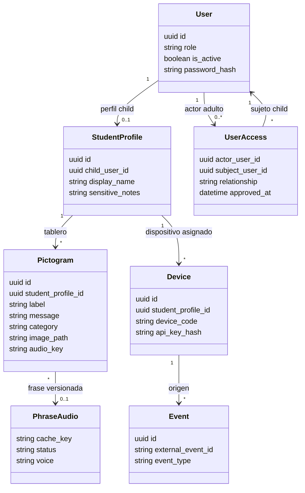
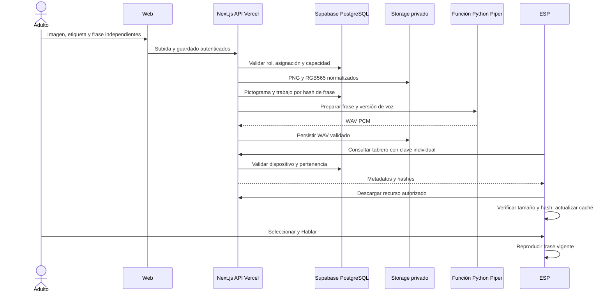
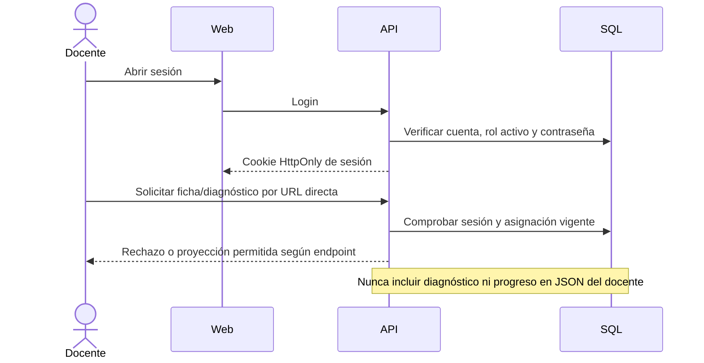

# Modelos de análisis y ejecución

Los nombres CL1/UC/SEQ/ACT son los localizadores de la matriz. Las entidades representan filas y relaciones de PostgreSQL; no se afirma que exista un ORM con esas clases.

## UC1–UC6 Casos de uso

UC1–UC6 conservan las referencias de la matriz; UC7/UC8 explicitan gestión administrativa y orientaciones. Las asociaciones se limitan además por rol y asignación.

Admin no recibe identidad ni clínica de niños. Child no es actor del portal adulto. El especialista redacta diagnóstico separado de orientaciones.

## CL1 Entidades y datos

Modelo lógico resumido: comprobar nombres físicos en migraciones y consultas antes de usarlo como DDL. Los informes y orientaciones se proyectan desde el backend por rol; no se descargan todas las filas al navegador para ocultarlas allí.

## SEQ1 Imagen y frase propias

Si falla voz/descarga, se muestra estado/error y no se reproduce silenciosamente una frase antigua. Cambiar frase cambia la clave del audio.

## SEQ2 Privacidad ante URL directa

Implementación: frontend/src/lib/server/portal.ts, access.ts, auth.ts; rutas antiguas también verificadas en integración.

## ACT1 Operación del comunicador

La cola admite 64; PF-03–05 fueron informados conformes por el autor, con trazas/conteos pendientes. Varios ESP no se probaron. Sin Wi-Fi no hubo voz en el ensayo. La zona táctil inferior defectuosa se evita con controles superiores y flechas laterales; no se considera reparada.
