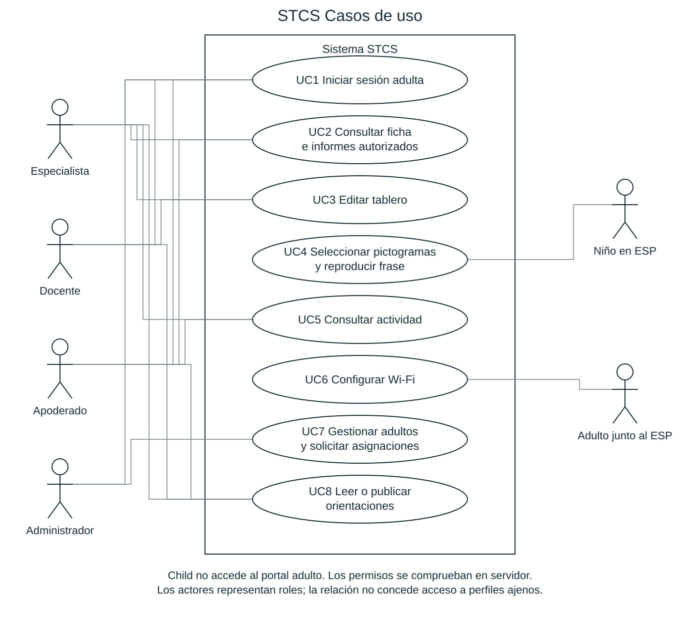
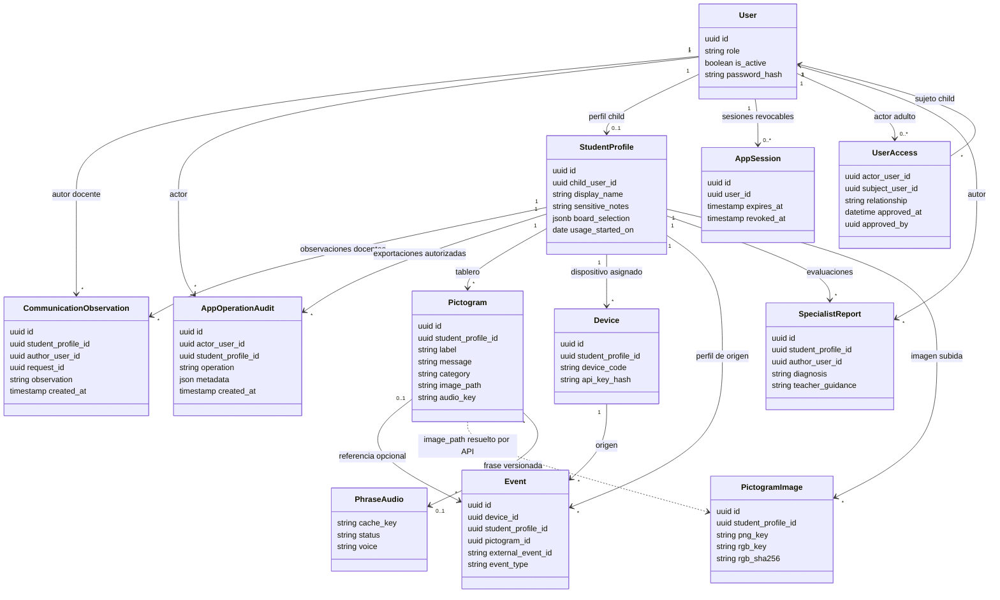
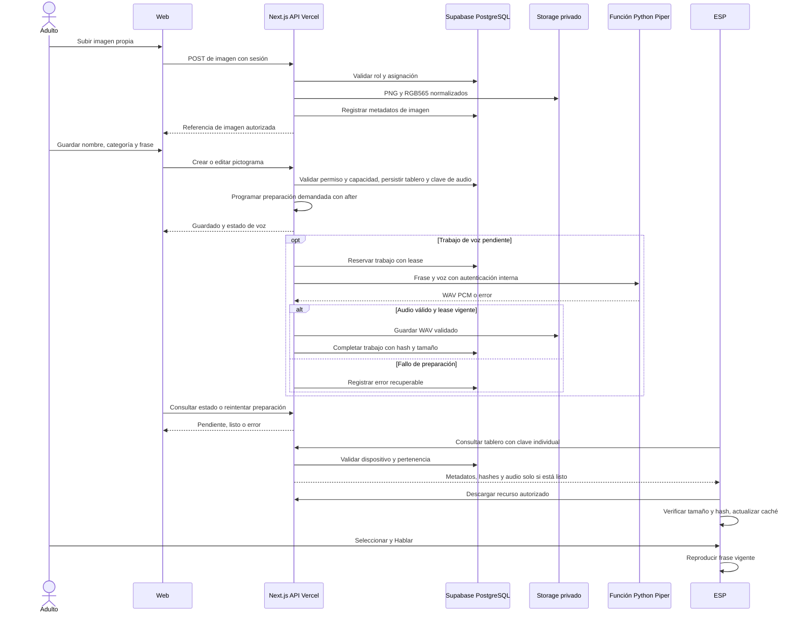
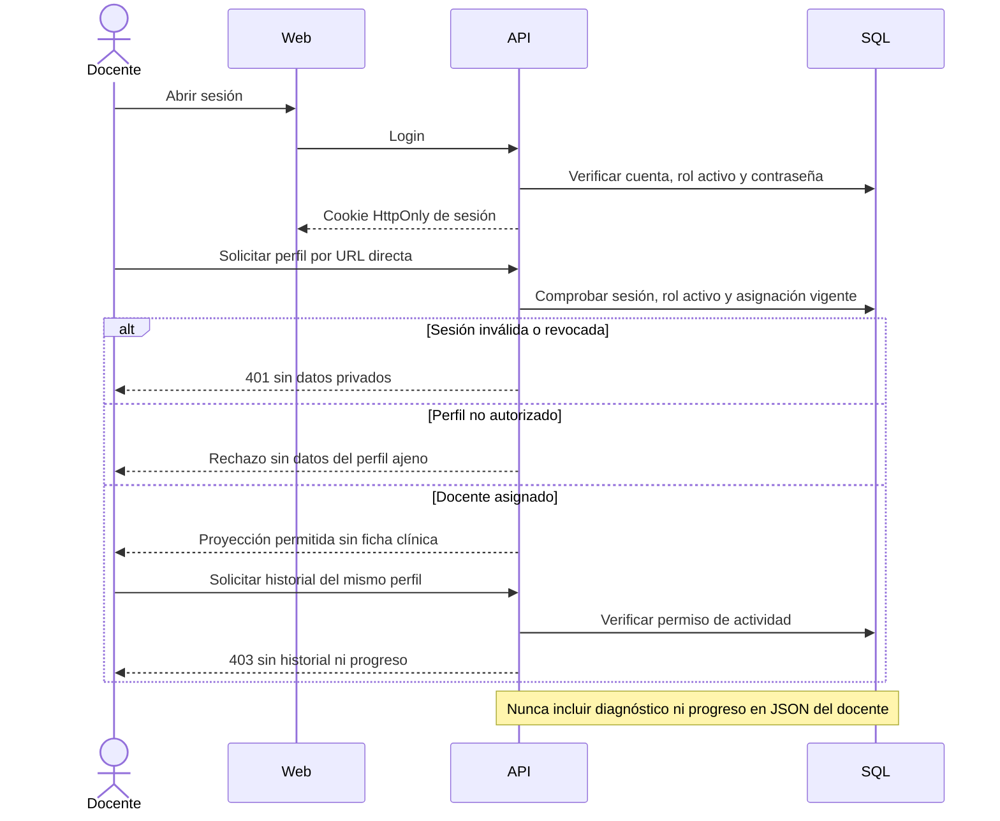
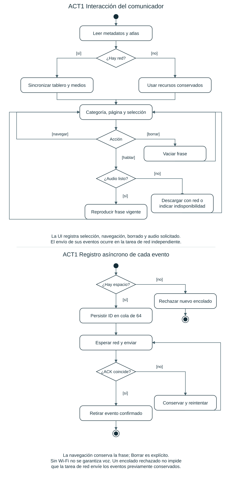

# Modelos de análisis y ejecución

Los nombres CL1/UC/SEQ/ACT son los localizadores de la matriz. Las entidades representan filas y relaciones de PostgreSQL; no se afirma que exista un ORM con esas clases.

## UC1–UC6 Casos de uso

UC1–UC6 conservan las referencias de la matriz; UC7/UC8 explicitan gestión administrativa y orientaciones. Las asociaciones se limitan además por rol y asignación.

Admin no recibe identidad ni clínica de niños. Child no es actor del portal adulto. El especialista redacta diagnóstico separado de orientaciones.

## CL1 Entidades y datos

La [vista resumida del informe](figuras/datos-resumen.svg) presenta los grupos principales; el diagrama siguiente conserva las asociaciones completas.

Modelo lógico resumido, no DDL ni ORM. User, StudentProfile, UserAccess, Device, Pictogram, Event, AppSession, PictogramImage, PhraseAudio y SpecialistReport corresponden respectivamente a users, student_profiles, user_access, devices, pictograms, device_events, app_sessions, pictogram_images, phrase_audio y specialist_reports. CommunicationObservation y AppOperationAudit representan communication_observations y app_operation_audit. Los nombres y relaciones se contrastan con el [esquema base](../../supabase/schema.sql), [sesiones/aprobaciones](../../supabase/migrations/20261111185152_audit_hardening.sql), [informes](../../supabase/migrations/20261111163114_role_based_portal.sql) y [medios](../../supabase/migrations/20261113215338_pictogram_media_audio.sql).

`pictogram_id` del evento puede ser nulo; `image_path` es una referencia resuelta por la API, no una FK directa a imágenes. `audio_key` sí referencia phrase_audio(cache_key). El evento conserva su perfil/dispositivo de origen y no se reasigna en este alcance. Los informes y orientaciones se proyectan por rol en servidor; no se descargan todas las filas para ocultarlas en el navegador.

## SEQ1 Imagen y frase propias

Si falla voz/descarga, se muestra estado/error y no se reproduce silenciosamente una frase antigua. Cambiar frase cambia la clave del audio; reutilizar una frase/voz ya preparada puede evitar nueva síntesis. La persistencia de objetos y la transacción SQL no se representan como una transacción distribuida atómica.

Implementación: [subida](../../frontend/src/app/api/stcs/images/route.ts), [guardado](../../frontend/src/app/api/stcs/pictograms/route.ts), [audio/estado](../../frontend/src/app/api/stcs/pictograms/[pictogramId]/audio/route.ts), [preparación demandada](../../frontend/src/lib/server/cloud-voice.ts), [media](../../frontend/src/lib/server/media.ts), [Storage](../../frontend/src/lib/server/media-store.ts), [función Piper](../../frontend/api/voice.py) y [red del ESP](../../firmware/STCS_UI_Arduino/STCS_Network.cpp). Pruebas: CP-RF03-U01–04/E01/E02 y PF-01; [A4](../trazabilidad.md).

## SEQ2 Privacidad ante URL directa

Implementación: [portal](../../frontend/src/lib/server/portal.ts), [asignaciones](../../frontend/src/lib/server/access.ts), [sesión](../../frontend/src/lib/server/auth.ts) y [eventos](../../frontend/src/app/api/stcs/events/route.ts); rutas antiguas también verificadas en integración. CP-RF02-E02 e I01 distinguen rechazo de proyección autorizada: una respuesta 200 de portal no implica que el docente reciba clínica.

## ACT1 Operación del comunicador

La cola admite 64; PF-03–05 fueron informados conformes por el autor, sin conteos instrumentados. Dos ESP físicos con información separada fueron confirmados por el propietario el 16/11; no acredita una flota mayor. Se prevé demostración presencial, sin exigir anexos audiovisuales adicionales. Sin Wi-Fi no hubo voz en el ensayo. La zona táctil inferior defectuosa se evita con controles superiores y flechas laterales; no se considera reparada.

## CL2 Auditoría de exportación publicada

El CSV ampliado registra generación, actor, perfil, filtros y cantidad en app_operation_audit. Su [migración aditiva](../../supabase/migrations/20261116214529_operation_audit.sql) se aplicó también en Supabase tras respaldo, con RLS y privilegios de servidor. No registra por sí sola toda petición denegada ni acredita apertura del archivo por el destinatario. [Implementación](../../frontend/src/lib/server/stcsData.ts), [pruebas](../pruebas/ARREGLOS_LOCALES_20261116.md).

## Correspondencia entre modelos, implementación y pruebas

| Modelo | Requisito | Código o esquema que lo respalda | Comprobación |
| --- | --- | --- | --- |
| UC1/UC2/UC7/UC8 y SEQ2 | H3-RF01/02/07/09, H3-RNF01 | auth/access/portal y tablas de asignación/sesión | CP-RF02-E01–04, API de permisos y rutas antiguas; sin autorización clínica del admin |
| UC3 y SEQ1 | H3-RF03/11 | media/cloud-voice, API y Storage privado | CRUD/imagen/validaciones, voz exacta y capacidad; fallos de red/voz no se ocultan |
| UC4 y ACT1 | H3-RF04/08 | Firmware C++ UI, audio y red | PF-01–05: confirmaciones del ejecutor, sin medición clínica |
| UC5 y CL1 | H3-RF05/10 | device_events, API y consultas por perfil | Deduplicación, historial y permisos; CSV ampliado con auditoría de exportación |
| UC6 | H3-RF06 | Menú/portal Wi-Fi del firmware | PF-06; asociación Wi-Fi no garantiza Internet/API |

Los diagramas no incorporan como operación real el motor predictivo FUT01 ni la gestión automática FUT03. Los actores Niño en ESP y Adulto junto al ESP no conceden acceso al portal a un registro child. Las asociaciones de casos de uso siempre se restringen además por perfil/asignación.

### Adaptación y seguimiento publicados

`board_selection` separa el catálogo de la selección que recibe el ESP. `NULL` conserva el tablero completo; una selección explícita guarda categorías e IDs autorizados. Los escritores del tablero comparten un bloqueo por perfil para impedir que una edición concurrente lo deje vacío. El dispositivo deriva las categorías visibles del contenido, sin recibir datos clínicos nuevos.

`usage_started_on` es una fecha de inicio de uso, no la fecha de creación del registro. `communication_observations` separa los comentarios del docente de los informes clínicos: el especialista asignado lee las observaciones del perfil y el docente solo las propias. RLS y revocación de permisos públicos complementan la autorización del servidor. Estas adiciones se publicaron mediante las migraciones aditivas aplicadas en Supabase y el PR #17; [comprobación final](../pruebas/reportes/comprobacion-final-20261121/README.md).
