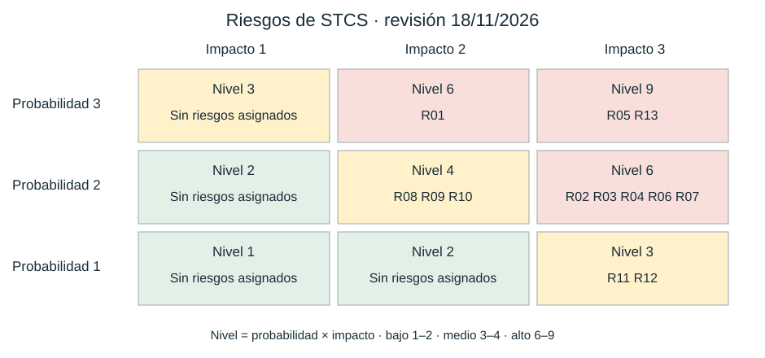

# A9 Riesgos y deuda técnica

Revisión documental del 21/11/2026; las fechas de cada riesgo conservan su seguimiento. Los riesgos se enlazan con requisitos/objetivos en [A4](trazabilidad.md#riesgos-enlazados-con-lo-que-amenazan).

## Escala y estado

Probabilidad e impacto: 1 bajo, 2 medio, 3 alto. Nivel = P × I: 1–2 bajo, 3–4 medio, 6–9 alto. Son valoraciones del proyecto, no frecuencias clínicas medidas. «Mitigado» o «aceptado» no significa reparado; «corregido» se limita a lo comprobado.

## Matriz de riesgos al cierre

| ID | Riesgo / requisito u objetivo | Probabilidad | Impacto | Nivel | Mitigación | Contingencia | Estado al cierre | Responsable | Seguimiento |
| --- | --- | --- | --- | --- | --- | --- | --- | --- | --- |
| R01 | Tacto inferior; OE1/H3-RF04 | Alta (3) | Medio (2) | Alto (6) | Controles arriba/laterales | Revisar hardware si falla la zona usable | Materializado y mitigado; defecto vigente, D04/PF-01 | Ignacio Benegas | 18/11/2026 |
| R02 | Tarjetas ausentes al reiniciar; H3-RF08 | Media (2) | Alto (3) | Alto (6) | Metadatos separados, atlas y refresco progresivo | Conservar tablero válido y reintentar descarga | D01 y nuevo D19: atlas ampliado dentro de la cuota y reemplazo de caché revisado; conserva el riesgo de redescarga tras expulsión o corte durante escritura | Ignacio Benegas | 18/11/2026 |
| R03 | Medios incompletos/obsoletos; H3-RF03 | Media (2) | Alto (3) | Alto (6) | Tamaño/hash/versión y error explícito | Reintentar sin reproducir otra frase | Descarga HTTPS incompleta corregida, D02/PR #6; sin frase clínica errónea acreditada | Ignacio Benegas | 18/11/2026 |
| R04 | Fuga de datos; H3-RF02/RNF01 | Media (2) | Alto (3) | Alto (6) | Permisos, proyecciones, sesiones y medios privados | Revocar/contener acceso y revisar sin exponer datos | Preventivo; negativos aprobados, sin fuga real acreditada; CSP medio residual | Ignacio Benegas | 18/11/2026 |
| R05 | Aceptación y adecuación individual incompletas; OE1/OE2 | Alta (3) | Alto (3) | Alto (9) | Acordar sesión y registrar decisión | Informar al profesor lo no evaluado | Reunión del 20/11 y aprobación de pertinencia confirmadas por Ignacio; adaptación publicada y comprobada físicamente el 22/11; indicadores con niños no medidos | Ignacio Benegas | 21/11/2026 |
| R06 | Evidencia sin acceso/tag; A4/A8 | Media (2) | Alto (3) | Alto (6) | Índice, enlaces y versión final | Resolver permisos y conservar copia de esa revisión | Enlaces y tag de entrega identificados en A8; el profesor debe abrirlos con su propia cuenta antes de la defensa | Ignacio Benegas | 18/11/2026 |
| R07 | Cola llena/corte; H3-RF05/08/RNF04 | Media (2) | Alto (3) | Alto (6) | 64 pendientes, ID estable, reintento hasta ACK | Recuperar red e informar nuevos registros rechazados | PF-03–05 conformes según autor; sin conteos/instantes instrumentados | Ignacio Benegas | 18/11/2026 |
| R08 | AP de configuración persistente; H3-RF06 | Media (2) | Medio (2) | Medio (4) | Activación deliberada y clave local | Reiniciar tras configurar | Limitación aceptada, sin timeout; no incidente de intrusión acreditado | Ignacio Benegas | 18/11/2026 |
| R09 | Red/cuotas/proveedores; OE2/OE4 | Media (2) | Medio (2) | Medio (4) | Storage persistente, caché y reintento | Red alternativa y apoyo comunicativo del adulto | Dependencia vigente; no agotamiento de cuota acreditado | Ignacio Benegas | 18/11/2026 |
| R10 | Extrapolar a flota; FUT02 | Media (2) | Medio (2) | Medio (4) | Limitar afirmación al ensayo disponible | Ampliar etapas/perfiles antes de escalar | Dos ESP conformes; diez clientes HTTP no equivalen a diez ESP | Ignacio Benegas | 18/11/2026 |
| R11 | Objetivos originales ausentes; A1/A4 | Baja (1) | Alto (3) | Medio (3) | Fuentes H1/H2 y equivalencias | Resolver contradicciones con las fuentes | Materializado/resuelto documentalmente; medición externa pendiente | Ignacio Benegas | 18/11/2026 |
| R12 | Pérdida al migrar/restaurar; A8/RNF04 | Baja (1) | Alto (3) | Medio (3) | Cambios aditivos, respaldo y destino nuevo | Detener escrituras y revisar recuperación/datos posteriores | Recuperación sintética aprobada; sin pérdida real ni restauración cloud acreditada | Ignacio Benegas | 18/11/2026 |
| R13/L-01 | Sin voz sin Wi-Fi; H3-RF03/08 | Alta (3) | Alto (3) | Alto (9) | Explicar dependencia y comprobar red | Restablecer conexión o apoyo alternativo | Materializado, aceptado por propietario, no corregido | Ignacio Benegas | 18/11/2026 |

[Defectos y tratamiento](pruebas/RESULTADOS.md#defectos-y-tratamiento), [pruebas físicas](pruebas/FISICAS_20261115.md), [multicliente](pruebas/MULTICLIENTE_20261116.md), [CSP](calidad/README.md#hallazgo-medio-residual-csp-style-src-unsafe-inline), [recuperación](pruebas/reportes/arreglos-locales-20261116/recuperacion.json) y [registro de revisión](evidencias/a9-revision-20261117.json).

## Mapa de probabilidad e impacto

Ubicación según la valoración de la tabla. El responsable da seguimiento; para R05 la evaluación corresponde al profesional, y para R06 se necesita comprobar el acceso del profesor.

## Deuda técnica priorizada

DT identifica deuda documental, no tickets nuevos. P1: privacidad/integridad y cierre; P2: operación antes de ampliar uso. Responsable técnico: Ignacio Benegas.

| ID / prioridad | Deuda / Jira | Impacto | Plan | Criterio de cierre |
| --- | --- | --- | --- | --- |
| DT-01 / P1 | CSP inline; R04, TCS-59 | Medio | Evaluar nonce/hash o refactor; probar UI/gráficos | ZAP sin ese aviso y E2E sin regresión; hoy residual justificado |
| DT-02 / Resuelta | CSV/filtros/auditoría; TCS-83 | Medio | Migración aditiva respaldada y PR #17 publicado | CSV y permisos comprobados en Vercel; [registro final](pruebas/reportes/comprobacion-final-20261121/README.md) |
| DT-03 / P1 | Plan ampliado posterior a algunas ejecuciones; TCS-88 | Medio | Fijar plan antes de repetir candidato; conservar denominadores | Reportes posteriores a ese plan; unitarias/TLS repetidas 17/11, sin refecha de otros ensayos |
| DT-04 / P2 | Recuperación cloud/flota no ensayada; R12/TCS-88 | Alto ante incidente | Restaurar SQL/objetos/configuración en destino aislado autorizado | Relaciones/hashes/permisos y procedimiento comprobados; hoy solo sintético local |
| DT-05 / P2 | Móviles y carga prolongada/flota; R10/TCS-85/88 | Medio | Ampliar matriz y etapas con datos ficticios | Muestras, duración, memoria/latencia/errores registrados; hoy dos motores y un iPhone/Safari acotado |
| DT-07 / Resuelta | Atribución visible de recursos; TCS-85 | Medio | Catálogo ARASAAC y créditos publicados | Página /creditos comprobada con tres roles en Chrome; manifiesto por archivo versionado |
| DT-08 / P2 | Tiempo histórico de actualización ≤15 s no garantizado; H2-OE4/TCS-60 | Medio | Revisar intervalo de consulta y preparación, acordar meta y repetir en condiciones representativas | Todas las muestras de la meta acordada conformes; PC-01 LAN tuvo 5/6 ≤15 s y máximo 16,889 s |
| DT-06 / P2 | Convención histórica desigual y comprobación de acceso del evaluador; TCS-60/88 | Medio | PR final con tickets y evidencia; verificar permisos del profesor | Tag hito3 fija la entrega; no se reescriben commits históricos ni se atribuye aprobación clínica a tareas técnicas |

## Plan de mejora por etapas

1. **Entrega actual:** conservar las decisiones y observaciones de TCS-77, los resultados de los ajustes y los límites de medición. DT-01 registra el residual de estilos; DT-02/03/06 separan comprobación, método y versión.
2. **Antes de escalar:** ejecutar DT-04/05 y revisar R04/R10/R12 con nuevos equipos/entornos.
3. **Evolución:** acordar y probar motor predictivo FUT01 y vinculación/rotación/reasignación web FUT03. TCS-53 actual cubre equipos previamente configurados. Hardware, cierre automático de AP y voz offline requieren otro alcance/pruebas.

La evidencia se identifica por revisión y entorno. El registro audiovisual recomendado por el profesor no se sustituye por una afirmación de que una demo futura ya ocurrió. [Índice de evidencia](DEFENSA.md).

## Antes de un entorno real

Un piloto con menores requiere revisión profesional/institucional, autorizaciones y consentimiento/asentimiento aplicables, seguridad física y política de datos/retirada/borrado coherente con respaldos. La defensa con adultos y datos ficticios no acredita esas condiciones ni mejora clínica. [A1](objetivos.md), [A2](requerimientos.md), [pauta](validacion/PAUTA.md).
